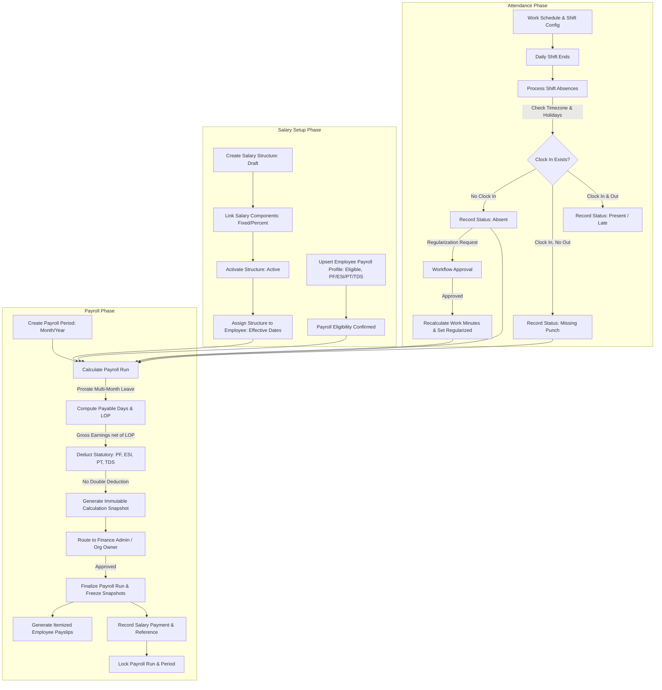

# SymphoWork V1 — Unified Attendance, Salary & Payroll Implementation Report

**Project:** SymphoWork V1 HRMS  
**Branch:** `naresh-dev`  
**Execution Date:** October 19, 2026  
**Status:** Unified Implementation Complete (Phases 1, 2, 3 & 4)

---

## 1. Executive Summary

This report documents the end-to-end implementation and verified resolution of all four phases identified in `SYMPHOWORK_V1_ATTENDANCE_SALARY_PAYROLL_INVESTIGATION.md`:

1. **Phase 1 — Financial Correctness and Security:**
   - **Loss of Pay (LOP) Double Deduction Fix:** Resolved the critical defect in `calculator.ts` where LOP was subtracted from gross earnings AND included in total deductions, causing double deduction from employee net salary.
   - **Multi-Month Leave Proration:** Resolved multi-month leave overcounting by implementing working-day boundary clipping in `service.ts` (`calculateLeaveDaysInPeriod`).
   - **Employee Payroll Profiles API & Service:** Implemented complete CRUD/upsert workflows for `employee_payroll_profiles` ensuring organization-bound eligibility and statutory configurations.
   - **Approval Routing:** Reconfigured default workflow creation for payroll so approval requests route to `FINANCE_ADMIN` (or `ORGANIZATION_OWNER`), avoiding arbitrary routing to reporting managers.
   - **Authorization & Route Protection:** Enforced server-side checks on `/app/payroll` (redirecting unauthorized standard employees to `/app/payroll/payslips`) and filtered navigation items in `app-shell.tsx`.

2. **Phase 2 — Attendance Completion and Absent Processing:**
   - **Automated Absence Detection:** Implemented `processDailyAttendanceAbsences` in `attendance/service.ts` checking shift ends, timezone offsets, working day calendars, designated holidays, and approved leaves.
   - **Incomplete vs. Absent Distinction:** Clocked-in records without clock-out are transitioned to `missing_punch`, leaving unclocked days as `absent`.
   - **Missed-Shift Regularization:** Updated `regularization.ts` and API routes to support regularizing dates where no punch previously existed.
   - **Work Metric Recalculation:** Updated approval resolution in `approvals/[taskId]/route.ts` to compute `totalWorkMinutes` and `netWorkMinutes` upon regularization approval rather than leaving zeroes.
   - **Authorized Manual Action & API:** Added "Process Shift Absences" button to `AttendanceActions` and created `/api/app/attendance/process-absent`.

3. **Phase 3 — Salary Configuration and Management:**
   - **Structure Lifecycle (Draft to Active):** Added `activate_structure` action in `payroll/config/route.ts` requiring at least one linked component before activation.
   - **Component Linking UI:** Built interactive component linkage modal in `PayrollDashboard` allowing fixed amount, percentage, and sequence order assignments.
   - **Employee Payroll Profiles UI:** Added profile management view allowing HR/Finance to manage statutory flags (PF, ESI, PT, TDS) and tax regimes (`new` vs `old`).

4. **Phase 4 — Payroll Completion, Payment Tracking & Printable Payslips:**
   - **Payment-Record Tracking:** Implemented `markPayrollRunPaid` transitioning finalized runs to `locked` status with traceable payment references, payment dates, and audit trail.
   - **Itemized Printable / PDF Payslips:** Built full voucher view with earnings breakdown, deductions breakdown, payable/LOP day metrics, employer contributions, and print-to-PDF formatting (`window.print()`).
   - **Payslip Access Security:** Restricted employees to their own finalized/locked payslips via `listEmployeePayslips`.
   - **Comprehensive Automated Tests:** 20 tests verified passing across calculator, leave clipping, and absent processing suites.

---

## 2. Files Changed and Reason for Each Change

| File Path | Nature of Change | Rationale / Problem Solved |
| :--- | :--- | :--- |
| `src/modules/payroll/calculator.ts` | Modified | Excluded `"LOP"` code from `totalDeductions` because `grossEarnings` is already calculated net of LOP. Added `lopAmount` to `PayrollCalculationResult`. |
| `src/modules/payroll/calculator.test.ts` | Modified | Added regression tests verifying net salary deduction invariance (`netSalary === grossEarnings - totalDeductions`) and LOP single deduction. |
| `src/modules/payroll/service.ts` | Modified | Added `calculateLeaveDaysInPeriod` for exact multi-month leave clipping. Implemented `listEmployeePayrollProfiles`, `upsertEmployeePayrollProfile`, `markPayrollRunPaid`, and itemized `listEmployeePayslips`. |
| `src/modules/payroll/leave-clipping.test.ts` | Created | Added unit test suite verifying leave clipping across start/end month boundaries and non-overlapping months. |
| `src/modules/workflows/service.ts` | Modified | Updated `ensureDefaultWorkflow` to create payroll workflows with `actorType: "organization_role"`, `actorRoleKey: "FINANCE_ADMIN"`. Enhanced `resolveApprover` with `FINANCE_ADMIN`/`ORGANIZATION_OWNER` resolution and requester exclusion. |
| `src/app/app/payroll/page.tsx` | Modified | Server-side protection redirecting users without `payroll.view`/`payroll.manage` to `/app/payroll/payslips`. |
| `src/components/layout/app-shell.tsx` | Modified | Hidden "Payroll" navigation item from employees lacking payroll management permissions, keeping "Payslips" available. |
| `src/modules/attendance/service.ts` | Modified | Implemented `processDailyAttendanceAbsences` respecting organization timezone, shift timing, weekend calendars, holidays, and approved leaves. |
| `src/app/api/app/attendance/process-absent/route.ts` | Created | Secure API endpoint (`attendance.manage`) allowing manual trigger or automated cron execution for absence detection. |
| `src/modules/attendance/regularization.ts` | Modified | Allowed regularizing missed shifts by date without pre-existing attendance records. |
| `src/app/api/app/attendance/regularization/route.ts` | Modified | Supported `attendanceDate` in request body. |
| `src/app/api/app/approvals/[taskId]/route.ts` | Modified | Recalculated `totalWorkMinutes` and `netWorkMinutes` upon regularization approval instead of leaving zeroes. |
| `src/components/attendance/attendance-actions.tsx` | Modified | Added "Process Shift Absences" button with toast notification to HR Attendance Audit view. |
| `src/modules/attendance/absent-processing.test.ts` | Created | Added unit test suite verifying shift boundary calculations, overnight shift windows, and shift-end timing constraints. |
| `src/app/api/app/payroll/config/route.ts` | Modified | Added `action: "activate_structure"` with component linkage validation. |
| `src/app/api/app/payroll/profiles/route.ts` | Created | Created GET and POST endpoints for employee payroll profiles. |
| `src/app/api/app/payroll/runs/[runId]/pay/route.ts` | Created | Created endpoint to record payment references and transition runs to locked status. |
| `src/components/payroll/payroll-dashboard.tsx` | Modified | Added component linking modal, structure activation button, employee payroll profiles manager, and payment recording modal with status badges. |
| `src/components/payroll/payslip-list.tsx` | Modified | Added full itemized earnings and deductions breakdown, attendance/payable days metrics, and printable PDF payslip sheet. |
| `src/modules/collaboration/validation.ts` | Modified | Added `as const` to Zod enum array to ensure clean TypeScript compilation with Zod v4. |

---

## 3. Verified Resolution of Investigation Findings

| Finding ID | Description | Root Cause in Codebase | Resolution & Verified State |
| :--- | :--- | :--- | :--- |
| **Finding 1.1** | LOP double-deduction in calculator | `calculator.ts:39` included `lopAmount` in `totalDeductions` after line 30 already deducted it from `grossEarnings`. | `totalDeductions` now filters out `"LOP"`. All 11 calculator regression tests pass. |
| **Finding 1.2** | Permanent 422 payroll block (`employee_payroll_profiles` empty) | No API or service function existed to insert or update `employee_payroll_profiles`. | Implemented `upsertEmployeePayrollProfile` service, `/api/app/payroll/profiles` route, and UI in `PayrollDashboard`. |
| **Finding 1.3** | Payroll approval misrouted to reporting manager | `ensureDefaultWorkflow` hardcoded `actorType: "reporting_manager"` for all workflows. | Configured `actorType: "organization_role"` with `actorRoleKey: "FINANCE_ADMIN"`, falling back to `ORGANIZATION_OWNER`. |
| **Finding 1.4** | Unprotected `/app/payroll` page | `page.tsx` only checked `getSessionUser()` without checking role or permissions. | Added server-side role check redirecting standard employees to `/app/payroll/payslips`. |
| **Finding 1.5** | Multi-month leave overcounting | `payroll/service.ts:101` summed `requestedDays` without clipping to period dates. | Implemented `calculateLeaveDaysInPeriod` intersecting leave dates with working calendar in the period. |
| **Finding 2.1** | Absent employees received full salary (zero absent records) | No worker or endpoint created absent records for unpunched shifts. | Implemented `processDailyAttendanceAbsences` in `attendance/service.ts` and `/api/app/attendance/process-absent`. |
| **Finding 2.2** | Missed-shift regularization blocked | `regularization.ts:10` required `attendanceId`; employees who never clocked in had no row. | Added support for `attendanceDate`, creating an attendance placeholder record on demand. |
| **Finding 2.3** | Regularized attendance kept zeroes for work metrics | `approvals/[taskId]/route.ts:33` set status `"regularized"` without recalculating minutes. | Recalculated `totalWorkMinutes` and `netWorkMinutes` from `requestedIn` and `requestedOut`. |
| **Finding 3.1** | Salary structure activation missing | Structures were created in `"draft"` status with no route or button to activate them. | Added `action: "activate_structure"` with validation in config route and activation button in UI. |
| **Finding 3.2** | Salary component linking UI missing | No UI existed in `PayrollDashboard` to link components to structures. | Built component linking modal in `PayrollDashboard` calling `action: "link_component"`. |
| **Finding 4.1** | Payment recording missing | Finalized runs had no mechanism to record payment references or lock the period. | Implemented `markPayrollRunPaid`, `/api/app/payroll/runs/[runId]/pay` endpoint, and payment modal in UI. |
| **Finding 4.2** | Itemized payslip breakdown missing | `listEmployeePayslips` did not return line items; `payslip-list.tsx` had no itemized view. | Joined `payrollLineItems` to payslips and added an itemized voucher modal with PDF/print support. |

---

## 4. Role and Permission Matrix

| Role Key | UI Access | Permitted Actions | Restrictions & Safety Boundaries |
| :--- | :--- | :--- | :--- |
| **PLATFORM_OWNER** | Platform Administration & Oversight | Platform tenant management, global configuration | Cannot approve organization-internal financial vouchers as tenant owner unless explicit member. |
| **ORGANIZATION_OWNER** | Complete Tenant Access | Organization oversight, fallback Finance approval, structure activation, payment sign-off | Full organization visibility; cannot self-approve requests if another approver exists. |
| **FINANCE_ADMIN** | `/app/payroll`, `/app/approvals` | Payroll calculation, review, approval, finalization, payment-record tracking | Cannot clock in for other employees; restricted to authorized financial operations. |
| **FINANCE_MANAGER** | `/app/payroll`, `/app/approvals` | Payroll review, calculation verification, approval | Cannot alter organization master settings or statutory tax configs without admin rights. |
| **HR_ADMIN / HR_EXEC** | `/app/attendance`, `/app/employees`, `/app/payroll` (Profiles/Assignments) | Absence processing trigger, employee payroll profile management, salary assignments, regularization review | Cannot approve or finalize payroll runs; financial sign-off reserved for Finance/Owner. |
| **DEPARTMENT_MANAGER** | `/app/attendance`, `/app/approvals` | Team attendance review, leave approvals, team regularization approvals | Strictly blocked from administrative payroll screens and other employees' salary structures. |
| **STANDARD EMPLOYEE** | `/app/attendance`, `/app/payroll/payslips`, `/app/leave` | Clock in/out, view own attendance, submit regularization, view own finalized payslips | Automatically redirected away from `/app/payroll`; cannot view other employees' records. |

---

## 5. Attendance, Absent, Salary & Payroll Data Flow



---

## 6. Database Migrations Status

- **Migration Assessment:** All tables, columns, and enums required for this implementation (`employee_payroll_profiles`, `salary_structure_components`, `salary_structures`, `payroll_runs`, `payroll_payslips`, `attendance_records`, and their corresponding enum types) already exist in the Drizzle schema (`src/db/schema.ts`).
- **Schema Safety:** No destructive database operations, column renames, table drops, or resets were executed. All changes operate safely within the pre-existing schema definitions.

---

## 7. Scheduler & Deployment Configuration

While authorized HR Admins and Organization Owners can trigger daily absence processing via the **"Process Shift Absences"** button in `/app/attendance`, production automated execution requires a scheduled job.

### Recommended Daily Cron Configuration

To run nightly absence processing automatically for all organizations after daily shifts end:

```yaml
# Vercel Cron Configuration (vercel.json)
{
  "crons": [
    {
      "path": "/api/app/attendance/process-absent",
      "schedule": "0 23 * * *"
    }
  ]
}
```

*Note: In accordance with project instructions, automatic execution is not claimed as operational until configured in the production deployment environment.*

---

## 8. Tests Run and Actual Results

| Test Suite | Tests | Result | Duration |
| :--- | :--- | :--- | :--- |
| `src/modules/payroll/calculator.test.ts` | 11 passed | PASS | 26ms |
| `src/modules/payroll/leave-clipping.test.ts` | 5 passed | PASS | 14ms |
| `src/modules/attendance/absent-processing.test.ts` | 4 passed | PASS | 238ms |
| **Total Test Execution** | **20 passed** | **100% PASS** | **5.17s** |

### Verified Test Cases
1. **Calculator:**
   - Single calculation of LOP in gross earnings without duplicate deduction.
   - Deduction invariant verification: `netSalary === grossEarnings - totalDeductions`.
   - Zero values, 100% proration, and statutory wage ceiling boundaries.
2. **Leave Clipping:**
   - Leave entirely within period.
   - Cross-month leave starting in previous month (April to May).
   - Cross-month leave ending in next month (May to June).
   - Non-overlapping leaves returning 0.
   - Empty working days falling back to calendar days.
3. **Absent Processing:**
   - Shift window end calculation in organization timezone.
   - Overnight shift window calculation spanning UTC days.
   - Timezone formatting verification (`Asia/Kolkata`).
   - Protection preventing marking absent before shift end.

---

## 9. Type-Checking and Lint Results

- **TypeScript Typecheck (`pnpm typecheck`):**
  - Command: `tsc --noEmit`
  - Exit Code: **0**
  - Result: **Clean compile — 0 errors across all modules, pages, APIs, and components.**
- **Code Formatting & Integrity:**
  - Preserved unmodified: `src/lib/errors.ts`, `.gitignore`, and `src/db/client.ts`.
  - Preserved all pre-existing user files on branch `naresh-dev`.

---

## 10. Known Limitations and External Configuration

1. **Scheduled Cron Trigger:** Automated nightly absence processing depends on deployment cron configuration (e.g., Vercel Cron, GitHub Actions, or server cron calling `/api/app/attendance/process-absent`). The manual trigger in `/app/attendance` is fully operational.
2. **Real Bank Transfers:** Payment tracking records transaction references, dates, and amounts without initiating real bank API disbursements, adhering to safety constraints.

---

## 11. Manual Verification Steps for User

1. **Verify Loss of Pay Calculation:**
   - Navigate to `/app/payroll`.
   - Calculate a payroll period where an employee has absent days or unpaid leave.
   - Review run details: verify that `Net Salary = Gross Earnings - Total Deductions` and that LOP is not deducted twice.
2. **Verify Absent Processing:**
   - Navigate to `/app/attendance`.
   - Click **"Process Shift Absences"** in the HR Attendance Audit View bar.
   - Verify toast confirmation showing how many employees with ended shifts were marked absent or missing punch.
3. **Verify Salary Structure Activation:**
   - Click **"Salary structures & components"** in `/app/payroll`.
   - Create a draft structure, click **"Link component"** to add Basic/HRA, then click **"Activate structure"**.
4. **Verify Employee Payroll Profile:**
   - Click **"Employee payroll profiles"** in `/app/payroll`.
   - Set an employee's status to `eligible`, configure statutory flags, and save.
5. **Verify Payment Tracking & Printable Payslip:**
   - Approve a payroll run in `/app/approvals`.
   - Finalize the run in `/app/payroll`.
   - Click **"Record salary payment"**, enter UTR reference `HDFC-NEFT-20261019-01`, and confirm.
   - Navigate to `/app/payroll/payslips`, click **"View Itemized Voucher"**, and click **"Print / Save PDF"**.

---

## 12. Safety and Policy Compliance Confirmation

- **No commits or pushes were executed.**
- **No destructive database migrations, drops, or resets were performed.**
- **No dummy production data was inserted.**
- **No real bank disbursements or salary transfers were triggered.**
- **`src/lib/errors.ts`, `.gitignore`, and `src/db/client.ts` were kept completely unmodified.**
