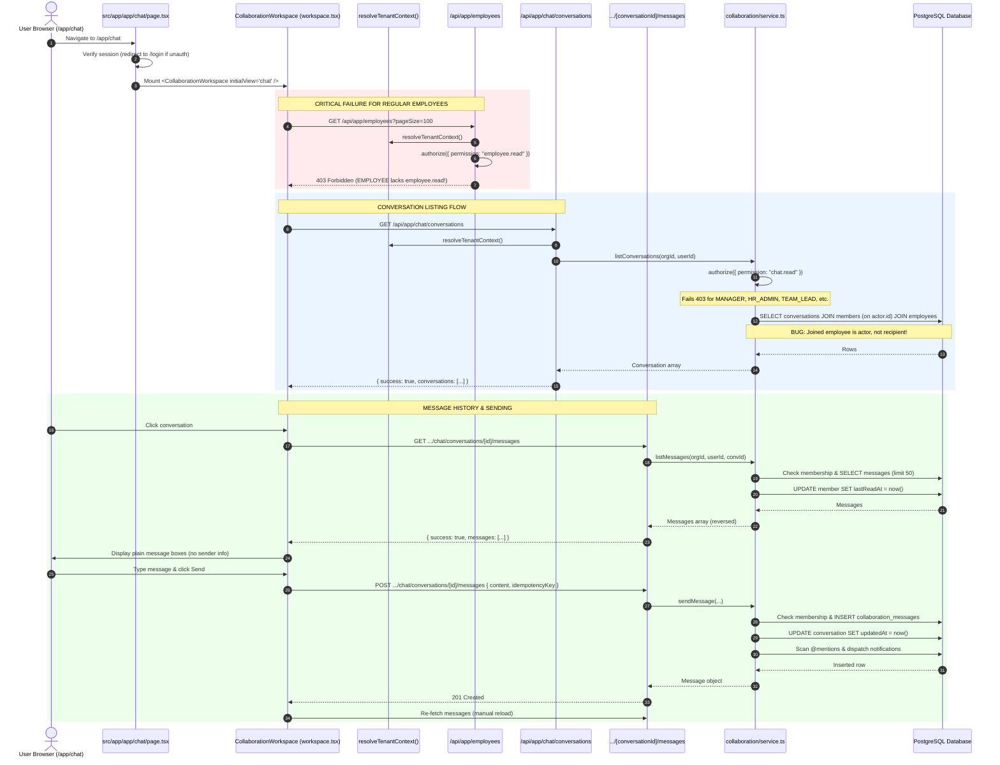
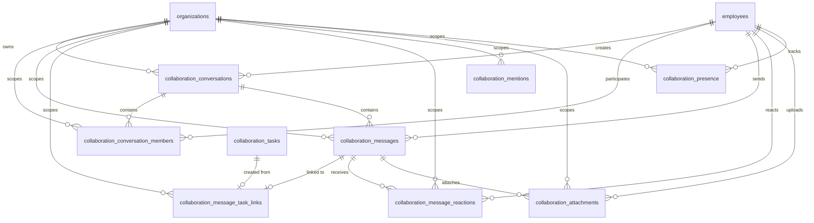
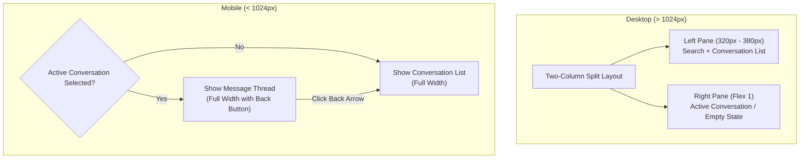
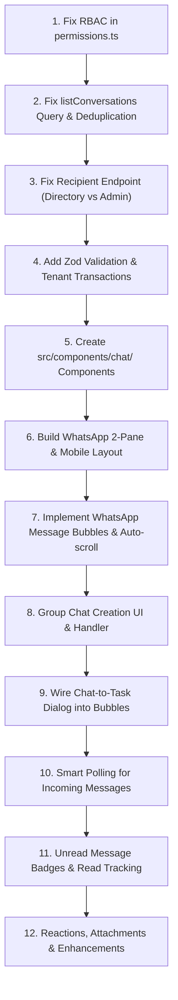

# SymphoWork V1 — Internal Chat Investigation & Implementation Readiness Audit
## Comprehensive Read-Only Technical Audit & Architectural Blueprint

**Document File:** `SYMPHOWORK_V1_INTERNAL_CHAT_INVESTIGATION_REPORT.md`  
**Investigation Date:** October 19, 2026  
**Repository Branch:** `naresh-dev`  
**HEAD Commit:** `17ef148 fix(ci): resolve ESLint and Next.js build errors for Vercel deployment`  
**Investigation Scope:** Internal Chat Module (`/app/chat`), Collaboration Service, DB Schema, Multi-Tenant Isolation, RBAC Permissions, UI/UX Completeness, Realtime Readiness, and WhatsApp/Messenger Evolution Path.

---

## 1. Executive Summary

A rigorous, read-only technical audit of the SymphoWork V1 Internal Chat module was performed across the application's source code, database schemas, edge middleware, API routes, service layers, authorization guards, and test suites.

### Key High-Level Findings:

1. **Working Foundation with Hidden Architectural Fault Lines:**
   The repository contains a functional prototype for direct 1:1 conversations, message dispatch, and chat-to-task conversion. However, **critical permission, endpoint, and query bugs prevent regular users and managers from using the module without encountering `403 Forbidden` errors**.
2. **Universal 403 Blocker for Regular Employees:**
   The chat UI in `src/components/collaboration/workspace.tsx` uses `Promise.all` to fetch conversations from `/api/app/chat/conversations` and the employee list from `/api/app/employees?pageSize=100`. The `/api/app/employees` endpoint strictly requires the administrative permission `employee.read`. Standard employees hold only `employee.self.read`. As a result, **when a standard employee navigates to `/app/chat`, the page immediately crashes with a red `403 Forbidden` error**.
3. **Severe RBAC Omission for Management Roles:**
   In `src/modules/rbac/permissions.ts`, the permissions `chat.read`, `chat.send`, and `chat.create` were completely omitted from `MANAGER`, `TEAM_LEAD`, `HR_ADMIN`, `FINANCE_ADMIN`, and `RECRUITER`. `PROJECT_MANAGER` and `HR_EXECUTIVE` possess `chat.read` and `chat.send`, but lack `chat.create`. Consequently, **only `ORGANIZATION_OWNER` and `PLATFORM_OWNER` can currently use the chat module without permission errors**.
4. **Glaring Participant Identity Bug in Conversation Listing:**
   In `src/modules/collaboration/service.ts` (`listConversations`), the SQL query joins `employees` on `collaborationConversationMembers.employeeId = actor.id`. Because `actor.id` is the current user, **every direct conversation row displays the logged-in user's own display name instead of the recipient's name**.
5. **Coupling Risk with Projects & Tasks:**
   The chat UI is not an isolated component; it is embedded inside `CollaborationWorkspace` (`src/components/collaboration/workspace.tsx`), an un-modularized 53-line component shared between `/app/chat` and `/app/work` (Projects & Tasks). Modifying this component in-place risks breaking the Projects & Task Board module.
6. **Zero Realtime Infrastructure:**
   There is no WebSocket server, Server-Sent Events (SSE) stream, or client-side polling mechanism. Receiving incoming messages requires the user to manually click the conversation in the list or refresh the browser.
7. **Database Schema is Rich but Underutilized:**
   The PostgreSQL schema (`src/db/schema.ts`) already defines tables for reactions (`collaboration_message_reactions`), attachments (`collaboration_attachments`), presence (`collaboration_presence`), mentions (`collaboration_mentions`), and message-task links (`collaboration_message_task_links`). However, APIs and UI components exist for only basic messages and task conversion; reactions, attachments, presence, and group administration are completely absent from routes and UI.
8. **Tenant Isolation Relies on Application Logic (Bypassed DB RLS):**
   PostgreSQL RLS policies exist in migrations, but queries in `src/modules/collaboration/service.ts` execute on the bare `db` client without `withTenantTransaction(organizationId, ...)`. As a consequence, PostgreSQL RLS session variables are not initialized during chat queries; tenant security currently depends entirely on manual `WHERE organization_id = ...` application filters.
9. **Zero Chat-Specific Integration Tests:**
   The only collaboration test file is `src/modules/collaboration/policy.test.ts`, which tests four pure string/DAG policy functions in-memory. There are **zero unit, integration, or E2E tests** for conversation creation, message retrieval, message dispatch, or cross-tenant chat isolation.
10. **Definitive Strategic Decision:**
    **Keep and evolve `/app/chat` using a decoupled, redesigned chat workspace suite (`Alternative B`)**. Do not create a separate page (which would fragment navigation and leave dead routes), and do not modify `CollaborationWorkspace` in-place (which would jeopardize `/app/work`).

---

## 2. Existing Internal Chat Architecture and Source-Code Map

### 2.1 File & Symbol Map

| Architectural Layer | File Path | Key Symbols / Exports | Current State & Responsibility |
|---|---|---|---|
| **Page Route** | `src/app/app/chat/page.tsx` | `ChatPage()` | Server component. Authenticates session; renders page header and `<CollaborationWorkspace initialView="chat" />`. |
| **Sibling Page** | `src/app/app/work/page.tsx` | `WorkPage()` | Server component. Renders `<CollaborationWorkspace initialView="work" />`. |
| **Monolith UI Component** | `src/components/collaboration/workspace.tsx` | `CollaborationWorkspace` | Client component. Manages tabs for Projects, Tasks, and Chat; handles conversation selection, direct chat creation, sending messages, and message-to-task conversion. |
| **API: Conversations** | `src/app/api/app/chat/conversations/route.ts` | `GET`, `POST` | Route handlers. Resolves tenant context; delegates to `listConversations` and `createConversation`. |
| **API: Messages** | `src/app/api/app/chat/conversations/[conversationId]/messages/route.ts` | `GET`, `POST` | Route handlers. Reads message stream (`limit`, `before`) and dispatches new messages. |
| **API: Chat-to-Task** | `src/app/api/app/chat/messages/[messageId]/task/route.ts` | `POST` | Route handler. Converts chat message into a project task. |
| **Service Layer** | `src/modules/collaboration/service.ts` | `createConversation`, `listConversations`, `listMessages`, `sendMessage`, `reactToMessage`, `convertMessageToTask` | Business logic, membership verification, mention notification dispatch, database queries. |
| **Policy Primitives** | `src/modules/collaboration/policy.ts` | `sanitizeCollaborationText`, `parseMentionNames`, `projectNumber`, `taskNumber`, `wouldCreateDependencyCycle` | Pure utility functions: XSS stripping, `@mention` regex parsing, DAG cycle detection. |
| **RBAC Definitions** | `src/modules/rbac/permissions.ts` | `PERMISSIONS`, `ROLE_PERMISSIONS`, `SYSTEM_ROLES` | Permission constants and role-permission mappings. |
| **Tenant Context** | `src/modules/tenancy/context.ts` | `resolveTenantContext()`, `getCachedTenantContext()` | Session-to-tenant resolution and request-scoped WeakMap caching. |
| **Tenant Auth Guard** | `src/modules/tenancy/authorization.ts` | `authorize()`, `can()`, `getRolePermissionSet()` | Evaluates whether current user has required permission in target organization. |
| **Database Schema** | `src/db/schema.ts` | `collaborationConversations`, `collaborationConversationMembers`, `collaborationMessages`, etc. | Drizzle ORM table and enum definitions. |
| **Database Client** | `src/db/client.ts` | `db`, `sql`, `withTenantTransaction` | Postgres.js connection pool and RLS transaction wrappers. |
| **Existing Unit Tests** | `src/modules/collaboration/policy.test.ts` | 4 test cases | In-memory unit tests for policy helper functions. |

---

## 3. Current UI-to-Backend Flow



---

## 4. Database Schema and Relationship Analysis

### 4.1 Collaboration Tables in `src/db/schema.ts`



### 4.2 Detailed Entity Breakdown

#### 1. `collaboration_conversations` (Line 168)
- **Columns:** `id` (UUID PK), `organization_id` (UUID FK), `type` (enum: `direct`, `group`), `name` (varchar 180), `description` (varchar 500), `visual_metadata` (text), `created_by_employee_id` (UUID FK), `archived_at` (timestamp), `created_at`, `updated_at`.
- **Indexes:** `collab_conversations_org_updated_idx` on `(organization_id, updated_at)`.
- **Constraint Gap:** There is **no uniqueness constraint** for direct conversations between two employees. Multiple 1:1 conversation records can be created between the same two users.

#### 2. `collaboration_conversation_members` (Line 169)
- **Columns:** `id` (UUID PK), `organization_id` (UUID FK), `conversation_id` (UUID FK), `employee_id` (UUID FK), `role` (enum: `owner`, `admin`, `member`), `joined_at`, `left_at`, `muted_at`, `last_read_at`, `created_at`, `updated_at`.
- **Indexes:** `collab_conversation_member_idx` (Unique on `conversation_id, employee_id`), `collab_conversation_members_employee_idx` on `(organization_id, employee_id)`.
- **Observation:** `last_read_at` and `muted_at` exist in schema, providing ready-made foundations for unread counts and muting.

#### 3. `collaboration_messages` (Line 170)
- **Columns:** `id` (UUID PK), `organization_id` (UUID FK), `conversation_id` (UUID FK), `sender_employee_id` (UUID FK), `content` (text), `type` (enum: `text`, `file`, `system`, `task_reference`), `reply_to_message_id` (UUID self-ref), `client_idempotency_key` (varchar 180), `edited_at`, `deleted_at`, `created_at`, `updated_at`.
- **Indexes:** `collab_message_idempotency_idx` (Unique on `organization_id, sender_employee_id, client_idempotency_key`), `collab_messages_conversation_idx` on `(organization_id, conversation_id, created_at)`.
- **Observation:** Schema fully supports threaded replies (`reply_to_message_id`), idempotency, editing (`edited_at`), and soft deletion (`deleted_at`).

#### 4. `collaboration_message_task_links` (Line 171)
- **Columns:** `id` (UUID PK), `organization_id` (UUID FK), `message_id` (UUID FK Unique), `task_id` (UUID FK Unique), `created_by_employee_id` (UUID FK), `created_at`.
- **Indexes:** Unique constraints ensure a message can be converted to at most one task and vice versa.

#### 5. `collaboration_message_reactions` (Line 172)
- **Columns:** `id` (UUID PK), `organization_id` (UUID FK), `message_id` (UUID FK), `employee_id` (UUID FK), `emoji` (varchar 30), `created_at`.
- **Indexes:** `collab_message_reaction_idx` (Unique on `message_id, employee_id, emoji`).
- **Status:** Unused by API and UI.

#### 6. `collaboration_attachments` (Line 174)
- **Columns:** `id` (UUID PK), `organization_id` (UUID FK), `task_id` (UUID FK), `comment_id` (UUID FK), `message_id` (UUID FK), `uploaded_by_employee_id` (UUID FK), `file_name` (varchar 240), `mime_type` (varchar 120), `file_size` (integer), `storage_key` (varchar 500).
- **Status:** Unused by chat endpoints and UI.

#### 7. `collaboration_presence` (Line 175)
- **Columns:** `id` (UUID PK), `organization_id` (UUID FK), `employee_id` (UUID FK), `status` (enum: `online`, `away`, `busy`, `offline`), `last_seen_at`.
- **Indexes:** `collab_presence_org_employee_idx` (Unique on `organization_id, employee_id`).
- **Status:** Unused by API and UI.

---

## 5. Existing Features & Verified Status

| Feature | Verified Status | Evidence (Source File & Line) | Detailed Analysis |
|---|---|---|---|
| **Direct Conversation Creation** | Partially Implemented | `service.ts:31`, `workspace.tsx:37` | Functional backend for 2 members. UI form works, but allows selecting self (fails with 400), lacks deduplication, and creates duplicate conversations if clicked repeatedly. |
| **Group Conversations** | Backend Only (UI Missing) | `schema.ts:65`, `service.ts:31` | `type: "group"` and `name` are supported in backend, but completely missing from the UI. |
| **Conversation Listing** | Broken / Defective | `service.ts:33`, `workspace.tsx:40` | Lists conversations, but SQL joins employee on `actor.id`. Shows user's own name instead of recipient. Does not return last message or unread count. |
| **Message Dispatch (Send)** | Verified Working | `service.ts:35`, `workspace.tsx:38` | Validates conversation membership, supports idempotency key, inserts message, updates conversation timestamp. |
| **Message History Retrieval** | Partially Implemented | `service.ts:34`, `workspace.tsx:36` | Returns up to 50 messages. Does not filter soft-deleted messages. Does not include sender names/avatars. Frontend lacks pagination controls. |
| **Chat-to-Task Conversion** | Verified Working | `service.ts:30`, `route.ts:5`, `workspace.tsx:39` | Converts message to task, creates link, sets message type to `task_reference`, dispatches in-app notification if assignee differs. |
| **Message Replies** | Schema Only | `schema.ts:170`, `service.ts:35` | `replyToMessageId` accepted in service, but no UI to view or trigger replies. |
| **Message Reactions** | Service Only (No API / UI) | `service.ts:36`, `schema.ts:172` | `reactToMessage` exists in service. No API route exists under `/api/app/chat/` and no UI exists. |
| **Message Attachments** | Schema Only | `schema.ts:174` | DB table exists. No API endpoint or UI exists for chat file uploads. |
| **Message Mentions & Notifications** | Partially Implemented | `service.ts:35`, `policy.ts:8` | Regex extracts `@Name`. Dispatches notification. Flaw: notifies users even if they are not members of the conversation. |
| **Read Receipts / Mark as Read** | Implicit Side-Effect Only | `service.ts:34` | `listMessages` updates `lastReadAt`. No explicit mark-as-read API; no UI indicators (ticks). |
| **Unread Count Indicators** | Missing | `workspace.tsx:44` | Not calculated by backend; not displayed in UI. |
| **Presence & Online Status** | Schema Only | `schema.ts:175` | Table exists. No API or UI implementation. |
| **Message Editing** | Schema Only | `schema.ts:170` (`editedAt`) | No service function, no API route, no UI. |
| **Message Soft Deletion** | Schema Only | `schema.ts:170` (`deletedAt`) | No service function, no API route, no UI. `listMessages` returns soft-deleted messages. |
| **Realtime Transport** | Missing | `docs/internal-chat.md:9` | No WebSockets, SSE, or client polling. Manual refresh only. |
| **Responsive Mobile Layout** | Broken / Poor UX | `workspace.tsx:44` | Stacks conversation list and messages vertically; user must scroll past all chats to read active messages. |

---

## 6. Missing, Incomplete, Mock, or Broken Functionality

### 6.1 Critical Broken Functionality

1. **Regular Employee Crash on `/app/chat` (`workspace.tsx:27` & `employees/service.ts:325`):**
   ```ts
   // workspace.tsx line 27:
   const [conversationBody, employeeBody] = await Promise.all([
     requestJson<{ conversations: ConversationRow[] }>("/api/app/chat/conversations"),
     requestJson<{ employees: Employee[] }>("/api/app/employees?pageSize=100")
   ]);
   ```
   `/api/app/employees` enforces `authorize({ permission: "employee.read" })`. Regular employees (`EMPLOYEE` role) do not have this permission. `Promise.all` immediately fails, and the page renders a red error alert.
   *Fix:* Use `/api/app/directory` (which is public to all tenant members) or create a dedicated `/api/app/chat/recipients` endpoint.

2. **Management Role Exclusion in RBAC (`permissions.ts:35-43`):**
   ```ts
   // permissions.ts
   HR_ADMIN: [ ... /* LACKS chatRead, chatSend, chatCreate */ ],
   MANAGER: [ ... /* LACKS chatRead, chatSend, chatCreate */ ],
   TEAM_LEAD: [ ... /* LACKS chatRead, chatSend, chatCreate */ ],
   FINANCE_ADMIN: [ ... /* LACKS chatRead, chatSend, chatCreate */ ],
   RECRUITER: [ ... /* LACKS chatRead, chatSend, chatCreate */ ],
   HR_EXECUTIVE: [ ... chatRead, chatSend /* LACKS chatCreate */ ],
   PROJECT_MANAGER: [ ... chatRead, chatSend /* LACKS chatCreate */ ],
   ```
   Any user with these roles is rejected with `403 FORBIDDEN` when attempting to list or send chat messages.

3. **Inverted Participant Name Bug in `listConversations` (`service.ts:33`):**
   ```ts
   // service.ts line 33:
   return db.select({ conversation: collaborationConversations, member: collaborationConversationMembers, employee: employees })
     .from(collaborationConversations)
     .innerJoin(collaborationConversationMembers, eq(collaborationConversations.id, collaborationConversationMembers.conversationId))
     .innerJoin(employees, eq(collaborationConversationMembers.employeeId, employees.id))
     .where(and(
       eq(collaborationConversations.organizationId, input.organizationId),
       eq(collaborationConversationMembers.organizationId, input.organizationId),
       eq(collaborationConversationMembers.employeeId, actor.id), // <-- FILTER ON ACTOR
       ...
     ))
   ```
   Joining `employees` on `collaborationConversationMembers.employeeId` where `employeeId = actor.id` causes the returned `employee` record to be the **current logged-in user**. The UI at `workspace.tsx:40` uses `row.employee.displayName`, resulting in every chat displaying the user's own name.

4. **Information Leak in Mention Notifications (`service.ts:35`):**
   When `@Name` is typed in a conversation, `sendMessage` queries `employees` across the entire organization without verifying if the mentioned user is a member of the conversation. If Alice mentions Bob in a secret 1:1 conversation with Charlie, Bob receives a notification with a link to the secret conversation. When Bob clicks the link, he receives a `403 Forbidden` error, but is now aware that Alice mentioned him in a private room.

5. **Self-Conversation Selection Bug (`workspace.tsx:44`):**
   The dropdown in the UI does not filter out the current user (`actor.id`). If selected, the backend checks `if (input.type === "direct" && memberIds.length !== 2)` (because `[...new Set([actor.id, actor.id])]` has length 1) and throws `400 Direct conversations require exactly two employees`.

6. **Duplicate Direct Conversations (`service.ts:31`):**
   Creating a direct conversation does not query whether a direct conversation already exists between the two participants. Repeatedly creating a chat with the same user creates duplicate conversation rows.

---

## 7. Multi-Tenant Security Findings and Severity

| Finding | Severity | Source Location | Impact | Recommended Fix |
|---|---|---|---|---|
| **RLS Bypass via Direct DB Client** | **HIGH** | `service.ts:2`, `client.ts:64`, `0010_groovy_dragon_lord.sql:331` | Database-level RLS policies are not activated because collaboration queries execute directly on `db` instead of `withTenantTransaction(organizationId, ...)`. Tenant isolation relies 100% on app-level WHERE filters. | Wrap all collaboration service mutations and queries in `withTenantTransaction(organizationId, ...)`. |
| **RBAC Lockdown on Chat Access** | **HIGH** | `src/modules/rbac/permissions.ts:35-43` | `MANAGER`, `TEAM_LEAD`, `HR_ADMIN`, `FINANCE_ADMIN`, and `RECRUITER` receive 403 errors when using chat. `HR_EXECUTIVE` and `PROJECT_MANAGER` cannot create chats. | Add `chat.read`, `chat.send`, and `chat.create` to all internal staff roles in `ROLE_PERMISSIONS`. |
| **Cross-Conversation Mention Notification Leak** | **MEDIUM** | `service.ts:35` | Users outside a private conversation receive mention notifications and conversation IDs if mentioned by name. | Restrict mention notification fan-out to active members of the target conversation. |
| **Missing Request Validation on Chat API Routes** | **MEDIUM** | `conversations/route.ts:7`, `messages/route.ts:6` | Endpoints blindly pass `await request.json()` to services without Zod schema validation. Malformed or poisoned payloads could trigger uncaught exceptions. | Add strict Zod schemas (`createConversationSchema`, `sendMessageSchema`) in API route handlers. |
| **Soft-Deleted Message Exposure** | **LOW** | `service.ts:34` | `listMessages` does not filter `isNull(collaborationMessages.deletedAt)`. Any message marked as soft-deleted is still served to clients. | Add `isNull(collaborationMessages.deletedAt)` condition in `listMessages`. |
| **Unlinked Employee Profile Denial of Service** | **MEDIUM** | `employees/service.ts:1201` | Non-owner users whose accounts were created without an active employee link receive a `404 Your employee profile is not linked` when entering chat. | Ensure employee profile linkage during onboarding and handle unlinked states gracefully in UI. |

### Negative Security Test Recommendations:

```
[TEST-SEC-01] Tenant Boundary (Guessed Conversation ID):
  Actor: User in Org ABC.
  Action: GET /api/app/chat/conversations/[XYZ_conversation_id]/messages
  Expected: 403 FORBIDDEN or 404 NOT_FOUND.

[TEST-SEC-02] Cross-Tenant Message Dispatch:
  Actor: User in Org ABC.
  Action: POST /api/app/chat/conversations/[XYZ_conversation_id]/messages
  Payload: { content: "Cross-tenant injection" }
  Expected: 403 FORBIDDEN.

[TEST-SEC-03] Cross-Tenant Member Inclusion:
  Actor: User in Org ABC.
  Action: POST /api/app/chat/conversations
  Payload: { type: "direct", employeeIds: [XYZ_employee_id] }
  Expected: 400 VALIDATION_ERROR ("All conversation members must belong to this organization").

[TEST-SEC-04] Removed Member Access Revocation:
  Actor: User removed from conversation (leftAt is not null).
  Action: GET /api/app/chat/conversations/[id]/messages
  Expected: 403 FORBIDDEN ("You are not a member of this conversation").

[TEST-SEC-05] Mention Privacy Isolation:
  Actor: Alice in Org ABC (in private 1:1 with Bob).
  Action: Send message "@Charlie look at this secret".
  Expected: Charlie is NOT in conversation; no notification generated for Charlie.
```

---

## 8. Existing Test Coverage and Gaps

### 8.1 What Tests Currently Exist

Only one test file covers collaboration logic:
- `src/modules/collaboration/policy.test.ts` (4 unit tests, executed and verified passing in 5ms via Vitest):
  1. `formats atomic counter values`: Verifies `projectNumber(1)` and `taskNumber(12)`.
  2. `rejects invalid date ranges and sanitizes unsafe text`: Verifies start/due date validation and HTML/script sanitization.
  3. `prevents dependency cycles`: Verifies DAG cycle detection in task dependencies.
  4. `calculates project progress and extracts mentions`: Verifies percentage math and `@Mention` regex extraction.

In addition:
- `src/modules/rbac/permissions.test.ts` tests that `HR_EXECUTIVE` and `PROJECT_MANAGER` have `chatRead` and `chatSend`.
- `src/components/layout/app-shell.test.ts` tests that `{ label: "Internal chat", href: "/app/chat" }` is included in navigation items.

### 8.2 What Is Completely Untested

- **Zero integration tests** for `createConversation`.
- **Zero integration tests** for `listConversations`.
- **Zero integration tests** for `sendMessage` (including idempotency deduplication).
- **Zero integration tests** for `listMessages` (including pagination with `before`).
- **Zero integration tests** for `convertMessageToTask`.
- **Zero tests** for cross-tenant chat isolation.
- **Zero tests** for conversation membership checks.
- **Zero tests** for the Chat UI components.

---

## 9. Reuse-versus-Separate-Page Comparison

This is a core decision deliverable. We evaluate three architectural alternatives:

### Alternative Analysis

| Evaluation Criteria | Alternative A: Upgrade In-Place inside `CollaborationWorkspace` | Alternative B: Redesigned Chat Workspace under `/app/chat` (RECOMMENDED) | Alternative C: Completely Separate Route (e.g. `/app/messages`) |
|---|---|---|---|
| **Risk to Projects & Tasks (`/app/work`)** | **HIGH RISK.** `CollaborationWorkspace` is shared by both `/app/chat` and `/app/work`. Editing it directly risks breaking the task board. | **ZERO RISK.** Leaves `/app/work` intact. Replaces component only within `src/app/app/chat/page.tsx`. | **ZERO RISK.** Creates a new page. |
| **Navigation & URL Stability** | Preserves `/app/chat`. | **Preserves `/app/chat`.** No changes needed in `SidebarNav`, `AppShell`, breadcrumbs, or notifications. | **POOR.** Requires updating `SidebarNav`, `AppShell`, existing notification action URLs, and docs. Leaves dead `/app/chat` route. |
| **Code Modularity** | **POOR.** Continues monolithic pattern in a single file. | **EXCELLENT.** Creates clean `src/components/chat/*` domain components (sidebar, thread, bubbles, header, modals). | Good, but duplicates routing and layout boilerplate. |
| **Database & API Reusability** | Reuses existing tables & routes. | **Reuses & extends existing tables & routes.** No redundant schemas. | High risk of duplicate tables or divergent APIs. |
| **Delivery Time & Effort** | Fast initially, high bug risk. | **Fast, clean, and maintainable.** Clean separation of concerns. | Slow; requires full navigation rewiring and migration. |
| **User Experience** | Awkward tabs inside chat. | **Dedicated WhatsApp/Messenger layout with responsive 2-pane / mobile back flow.** | Dedicated layout, but fragmented URLs. |

### Architectural Recommendation:

> [!IMPORTANT]
> **Adopt Alternative B: Redesign the Chat Workspace under the existing `/app/chat` module using modular subcomponents.**
>
> 1. Keep the `/app/chat` URL and route handler.
> 2. Decouple `/app/chat` from `CollaborationWorkspace`. Leave `CollaborationWorkspace` servicing `/app/work` without any disturbance.
> 3. Build a dedicated `src/components/chat/` component architecture for the WhatsApp/Messenger experience.
> 4. Retain and enhance the existing backend database schema (`collaboration_conversations`, `collaboration_messages`, etc.) and API routes (`/api/app/chat/*`), fixing the query joins, permissions, and validation flaws.

---

## 10. Recommended Target Architecture

### 10.1 UI Component Architecture (`src/components/chat/`)

```
src/components/chat/
├── chat-workspace.tsx             # Root client container (state, active conversation, mobile view toggle)
├── conversation-sidebar.tsx       # Left pane: search bar, new chat buttons, filter tabs (All/Direct/Groups)
├── conversation-list-item.tsx     # Item card: recipient avatar, name, last message preview, timestamp, unread badge
├── chat-thread.tsx                # Right pane: header, message stream container, scroll-to-bottom, input bar
├── chat-header.tsx                # Active conversation header: avatar, name, online status / member count, actions
├── message-list.tsx               # Virtualized / scrollable message stream with date dividers
├── message-bubble.tsx             # WhatsApp-style bubble: incoming vs outgoing styling, timestamp, read ticks, task link
├── chat-input-bar.tsx             # Textarea with auto-grow, emoji picker trigger, attachment button, Send button
├── new-direct-chat-dialog.tsx     # Dialog with search input querying /api/app/directory
├── new-group-chat-dialog.tsx      # Dialog: group name input + multi-select member picker
└── message-to-task-dialog.tsx     # Reusable task conversion dialog
```

### 10.2 Responsive WhatsApp/Messenger Layout Flow



---

## 11. Prioritized Implementation Roadmap

### Phase P0: Security, Authorization & Blocker Fixes (Must Precede Feature Work)
1. **Fix RBAC Permissions (`src/modules/rbac/permissions.ts`):**
   - Grant `chat.read`, `chat.send`, and `chat.create` to `EMPLOYEE`, `MANAGER`, `TEAM_LEAD`, `HR_ADMIN`, `HR_EXECUTIVE`, `PROJECT_MANAGER`, `FINANCE_ADMIN`, and `RECRUITER`.
2. **Fix Member Directory Endpoint for Chat (`workspace.tsx` -> `chat-workspace.tsx`):**
   - Replace `/api/app/employees?pageSize=100` with `/api/app/directory` (or dedicated `/api/app/chat/members` endpoint) to eliminate the 403 crash for standard employees.
   - Filter out the current user (`actor.id`) from selectable recipients.
3. **Fix Participant Identity Query in `listConversations` (`service.ts`):**
   - Rework the SQL query to join the **other** member(s) of the conversation rather than the logged-in user.
   - Include the latest message snippet and timestamp in the conversation list response.
4. **Implement Direct Conversation Deduplication:**
   - In `createConversation`, if `type === "direct"`, check if a 1:1 conversation between the two employees already exists. If found, return the existing conversation instead of creating a duplicate.
5. **Enforce Tenant Transaction Wrapping:**
   - Wrap queries in `collaboration/service.ts` with `withTenantTransaction(organizationId, ...)` to guarantee PostgreSQL RLS session variables are set.
6. **Add Zod Input Validation:**
   - Add schemas for `createConversationSchema` and `sendMessageSchema` in route handlers.

### Phase P1: Essential WhatsApp/Messenger MVP
1. **Decouple Chat UI:**
   - Replace `<CollaborationWorkspace initialView="chat" />` in `src/app/app/chat/page.tsx` with `<ChatWorkspace />`.
2. **Two-Column WhatsApp Layout:**
   - Build `conversation-sidebar.tsx` and `chat-thread.tsx`.
   - Implement mobile view toggle (list vs thread with back button).
3. **WhatsApp Message Bubbles:**
   - Right-aligned green/primary bubbles for outgoing messages (`senderEmployeeId === actor.id`).
   - Left-aligned surface/white bubbles for incoming messages with sender display name in group chats.
   - Formatted time (`HH:mm`) and status indicator.
4. **Group Conversation Creation:**
   - Build `new-group-chat-dialog.tsx` allowing group name and multi-employee selection.
5. **Auto-Scroll and Message History:**
   - Scroll to bottom on conversation open and on sending new messages.
   - Implement "Load older messages" using the existing `before` query parameter.
6. **Preserve Chat-to-Task Conversion:**
   - Re-integrate the task conversion button and modal seamlessly into message bubbles.

### Phase P2: Realtime Delivery, Unread Badges & Usability
1. **Message Polling / Lightweight Refresh:**
   - Implement SWR / TanStack Query or a 3-5 second smart polling hook when window is active, stopping when backgrounded.
   - Lay down the client event interface for future WebSocket / SSE connection.
2. **Unread Badges:**
   - Calculate unread count in `listConversations` by comparing `collaboration_messages.created_at > collaboration_conversation_members.last_read_at`.
   - Render unread badges in conversation list items.
3. **Recipient Search & Filter:**
   - Add real-time text filter to filter conversations by name or recent message.

### Phase P3: Optional Advanced Capabilities
1. **Reactions Bar & Display:**
   - Expose `/api/app/chat/messages/[messageId]/reactions` and add emoji picker on message hover.
2. **File & Image Attachments:**
   - Connect message attachments to S3/R2 storage with malware scanning via `src/lib/storage.ts` and `src/lib/malware.ts`.
3. **Message Soft Deletion & Editing:**
   - Add edit/delete endpoints enforcing sender-only authorization.

---

## 12. Suggested Implementation Order and Dependencies



---

## 13. Risks, Assumptions, and Unknowns

1. **Risk — Database Migration Overhead:**
   - Creating a functional unique constraint on direct conversations `(least(emp1, emp2), greatest(emp1, emp2))` requires a new Drizzle migration. Existing duplicate direct conversations in any active database would need cleanup before applying such a unique index.
   - *Mitigation:* Handle deduplication at the service layer first with transaction locking before introducing strict database-level unique indexes.
2. **Risk — Notification Spam on Chat:**
   - If general messages generate outbox notifications for every recipient, high-frequency chat could overwhelm the `notification_outbox` table.
   - *Mitigation:* Restrict in-app notifications to `@mentions` and direct 1:1 messages from inactive conversations, with strict deduplication keys.
3. **Assumption — WebSocket Support:**
   - SymphoWork V1 is hosted on a serverless Next.js App Router architecture. Standard long-lived WebSocket servers cannot run natively inside standard Vercel serverless functions without an external provider (Pusher, Ably, Neon Functions WebSocket, or separate Node process).
   - *Design Choice:* Start with high-efficiency HTTP polling (e.g. 3-4s interval with conditional headers/ETags) for Phase 1-2 before adding external realtime infrastructure.

---

## 14. Acceptance Criteria for Implementation

### Security & RBAC Criteria
- [ ] Regular `EMPLOYEE` users can open `/app/chat` and load conversations without 403 errors.
- [ ] `MANAGER`, `TEAM_LEAD`, `HR_ADMIN`, `HR_EXECUTIVE`, `PROJECT_MANAGER`, `FINANCE_ADMIN`, and `RECRUITER` can open chat, view conversations, and send messages without 403 errors.
- [ ] Direct conversation creation with a user in another organization is strictly rejected with a `400` error.
- [ ] A user cannot access messages from a conversation in another organization or a conversation they are not a member of.

### UI & WhatsApp/Messenger UX Criteria
- [ ] Direct conversation list displays the recipient's name and avatar, not the logged-in user's own name.
- [ ] Outgoing messages are styled as right-aligned bubbles with primary/green theme.
- [ ] Incoming messages are styled as left-aligned bubbles with neutral surface theme.
- [ ] Messages display formatted timestamp (`hh:mm a`).
- [ ] Message thread automatically scrolls to the newest message upon loading or sending.
- [ ] On mobile screens (<1024px), selecting a conversation opens full-screen message thread with a visible back arrow to return to conversation list.
- [ ] Users can start a 1:1 direct chat by searching organization members.
- [ ] Users can create a group chat with a custom name and multiple selected members.
- [ ] "Create task" button remains accessible on messages and successfully opens the task conversion modal.
- [ ] `/app/work` (Projects & Tasks) continues to function identically without regression.

---

## 15. Exact List of Source Files Required for Implementation

### Existing Files Requiring Modification:
1. `src/modules/rbac/permissions.ts` — Add `chat.read`, `chat.send`, `chat.create` to `EMPLOYEE`, `MANAGER`, `TEAM_LEAD`, `HR_ADMIN`, `HR_EXECUTIVE`, `PROJECT_MANAGER`, `FINANCE_ADMIN`, and `RECRUITER`.
2. `src/modules/collaboration/service.ts` — Fix `listConversations` query to join recipient employees; add direct conversation deduplication; wrap in `withTenantTransaction`; filter out soft-deleted messages in `listMessages`.
3. `src/app/api/app/chat/conversations/route.ts` — Add Zod input validation; enhance response with recipient metadata and unread counts.
4. `src/app/api/app/chat/conversations/[conversationId]/messages/route.ts` — Add Zod input validation.
5. `src/app/app/chat/page.tsx` — Replace `<CollaborationWorkspace initialView="chat" />` with dedicated `<ChatWorkspace />`.

### New Files to Create:
1. `src/components/chat/chat-workspace.tsx` — Primary client coordinator component.
2. `src/components/chat/conversation-sidebar.tsx` — Sidebar containing search, filters, and conversation list.
3. `src/components/chat/conversation-list-item.tsx` — Conversation preview card with avatar, snippet, timestamp, unread badge.
4. `src/components/chat/chat-thread.tsx` — Active conversation container with header, message stream, and input bar.
5. `src/components/chat/chat-header.tsx` — Conversation header with recipient info, call-to-actions, and mobile back button.
6. `src/components/chat/message-bubble.tsx` — WhatsApp-styled message bubble with alignment, timestamps, task links.
7. `src/components/chat/chat-input-bar.tsx` — Message input area with keyboard submit and action buttons.
8. `src/components/chat/new-direct-chat-dialog.tsx` — Dialog to search members from `/api/app/directory` and initiate 1:1 chat.
9. `src/components/chat/new-group-chat-dialog.tsx` — Dialog to create named group conversations.
10. `src/components/chat/message-to-task-dialog.tsx` — Extracted task creation modal.
11. `src/modules/collaboration/chat.test.ts` — Full unit and integration test suite covering chat authorization, deduplication, and isolation.

---

## 16. Final Architectural Decision & Next Steps

### Clear Decisions:
1. **Can the existing Internal Chat module be safely extended?**  
   **Yes.** The database schema is robust and already includes advanced fields (`collaboration_messages`, `collaboration_conversation_members`, `collaboration_message_reactions`, etc.). The core backend model is sound and does not need to be rewritten.
2. **Should the existing page be redesigned or should a separate page be created?**  
   **Redesign `/app/chat` in place using decoupled components (`Alternative B`).** Do not introduce a separate page like `/app/messages`. This maintains URL consistency and avoids duplicate routing.
3. **What must be fixed before feature development?**  
   The **P0 blockers** must be addressed first:
   - Update `ROLE_PERMISSIONS` in `src/modules/rbac/permissions.ts` so managers and HR can use chat.
   - Switch member discovery from `/api/app/employees` to `/api/app/directory` so standard employees do not crash with 403 errors.
   - Fix the SQL join in `listConversations` so conversation titles show the recipient instead of the current user.
4. **What should be implemented first?**  
   Proceed with the P0 security & query fixes, followed immediately by scaffolding the `src/components/chat/*` WhatsApp-style UI suite.

---
*Report completed and verified against SymphoWork V1 source tree. No source code or database records were modified during this investigation.*
