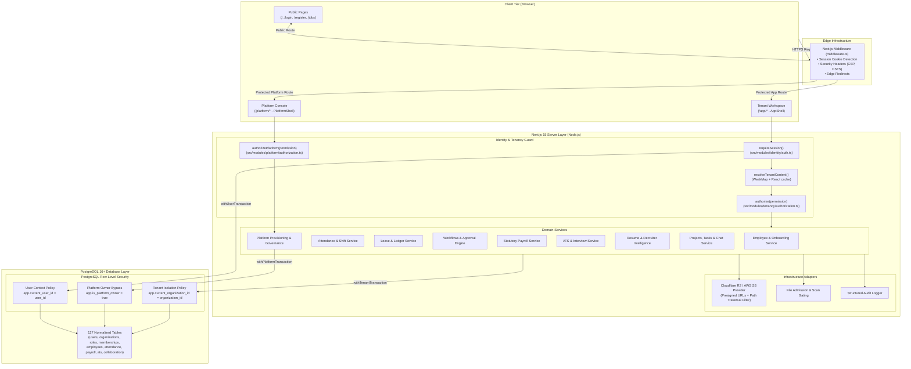

# SymphoWork V1 — Complete Codebase Understanding & Architecture Audit Report

**Date of Audit:** October 17, 2026  
**Auditor:** Senior Software Architect, Full-Stack Engineer, Database Architect & Application Security Auditor  
**Repository:** `Symphowork_V1_NM`  
**Status:** Complete Read-Only Static Verification & Structural Audit  

---

## 1. Executive Summary

**SymphoWork V1** is an enterprise-grade, multi-tenant Human Capital Management (HCM), Applicant Tracking System (ATS), Recruiter Intelligence, and Team Productivity platform built with **Next.js 15 (App Router)**, **React 19**, **TypeScript**, and **PostgreSQL** via **Drizzle ORM**.

The application enforces a **dual-plane product separation**:
1. **Platform Plane (`/platform`)**: An isolated, cross-tenant administration control plane operated exclusively by platform authorities (`PLATFORM_OWNER`, `PRODUCT_OWNER`, `PLATFORM_ADMIN`, `PLATFORM_SUPPORT`, `PLATFORM_BILLING`) to provision, configure, approve, monitor, and commercially govern tenant organizations.
2. **Tenant Workspace Plane (`/app`)**: An organization-scoped workspace providing workforce directory, attendance tracking, leave management, multi-step approval workflows, effective-dated payroll, expense claims, ATS recruitment pipelines, projects/tasks, and real-time collaboration.

Multi-tenancy is enforced through **defense-in-depth**:
- **Application Layer**: Dynamic session context resolution (`resolveTenantContext`) strictly binds the active user to a single organization through a database-enforced 1-to-1 membership constraint (`memberships.userId` is `UNIQUE`).
- **Authorization Layer**: Granular Role-Based Access Control (RBAC) evaluates statically verified permissions (`can`, `authorize`, `canAny`, `authorizeAny`) before allowing any service operation.
- **Database Layer**: Every tenant-scoped PostgreSQL table is equipped with **Row-Level Security (RLS)** policies that enforce isolation via PostgreSQL transaction-local configuration settings (`set_config('app.current_organization_id', ...)`).

---

## 2. Project Purpose and Scope

### Purpose
SymphoWork V1 is designed to replace fragmented HR and workplace tools with a unified, tenant-isolated system of record for growing companies, providing:
- Full employee lifecycle governance (invitation, onboarding, status transitions, exit).
- Time & attendance tracking with shift allocation, overtime, break compliance, and regularization workflows.
- Configurable multi-level approval workflows for leaves, expenses, attendance corrections, requisitions, and payroll.
- Statutory India payroll calculation engine (PF, ESI, Professional Tax, TDS) with immutable audit snapshots.
- Applicant Tracking System (ATS) with public job listings, candidate pipelines, interview scheduling, and deterministic resume field extraction.
- Organization-scoped project task boards, task dependency management, and Chat-to-Task conversion.
- SaaS commercialization engine managing tiered subscriptions, feature quotas, and licensing limits.

### Scope of Implementation
- **Implemented & Verified:**
  - Complete identity, session, email verification, password reset, and invitation acceptance flows.
  - Multi-tenant data model across 127 tables with PostgreSQL RLS policies.
  - 10 distinct tenant roles and 5 platform roles with complete permission mappings.
  - Core HR master data (departments, designations, locations, shifts, teams, employment types, holidays).
  - Attendance check-in/out engine, break tracking, and regularization requests.
  - Leave balance ledgers, accrual calculations, and multi-tier approval routing.
  - Workflow engine supporting sequential and parallel multi-actor approvals.
  - ATS core (job requisitions, public candidate application, pipeline stages, interview feedback).
  - Deterministic resume parsing, field extraction review, and candidate skill matching.
  - Collaboration module with projects, tasks, comments, task dependencies, channels, and chat messages.
  - Platform operations (tenant creation, provisioning jobs, commercial tiers, support notes, audit logs).
- **Intentionally Deferred / Stubbed in V1 Foundation:**
  - External LLM / vector embedding integrations (`ats_embeddings` tables exist; semantic search runs with deterministic fallback).
  - Production payment gateway webhooks (billing provider runs in stub/mock mode).
  - WebSocket / SSE push channels (polling / request-driven UI).
  - External binary resume parsing (PDF/DOCX binary stream decoding defaults to text-compatible extractor unless external provider is configured).

---

## 3. Verified Technology Stack

| Layer | Technology | Version | Purpose / Evidence |
|---|---|---|---|
| **Runtime & Framework** | Next.js (App Router) | `^15.5.4` | Full-stack server and client routing (`package.json`) |
| **UI Library** | React | `^19.1.1` | View layer with React Server Components (`package.json`) |
| **Language** | TypeScript | `^5.9.2` | Strict type checking (`tsconfig.json`) |
| **Styling** | Tailwind CSS | `^4.1.13` | Utility-first CSS styling (`postcss.config.mjs`) |
| **UI Primitives** | Radix UI | `@radix-ui/*` | Accessible primitives: Dialog, Dropdown, Avatar, Label (`package.json`) |
| **Icons** | Lucide React | `^0.544.0` | Application icon system (`package.json`) |
| **Validation** | Zod | `^4.1.5` | Request and schema validation (`package.json`) |
| **Database** | PostgreSQL | `Postgres 16+` | Relational data store (`drizzle.config.ts`) |
| **Database Driver** | postgres (postgres.js) | `^3.4.7` | Pooled client driver with transaction RLS support (`src/db/client.ts`) |
| **ORM & Migrations** | Drizzle ORM / Kit | `^0.45.3` / `^0.31.4` | Schema declaration, migrations, and type-safe SQL (`src/db/schema.ts`) |
| **Object Storage** | AWS S3 SDK | `^3.1139.0` | Cloudflare R2 / S3 compatible object storage (`src/lib/storage/r2.ts`) |
| **Package Manager** | pnpm | `11.19.0` | Dependency and workspace management (`package.json`) |
| **Testing Engine** | Vitest | `^3.2.4` | Unit, service, and policy test suite (`vitest.config.ts`) |
| **E2E Testing** | Playwright | `^1.55.0` | Browser-driven workflow testing (`playwright.config.ts`) |
| **Linting & Formatting** | ESLint & Prettier | `^9.35.0` / `^3.6.2` | Code quality and formatting (`eslint.config.mjs`) |

---

## 4. Repository Structure

```
Symphowork_V1_NM/
├── docs/                        # Architecture decisions & module specifications
├── drizzle/                     # 20 SQL migration files (0000 to 0019) with RLS policies
│   ├── meta/                    # Drizzle schema snapshot metadata
│   └── 0000_... to 0019_...sql  # Incremental schema evolution and RLS definitions
├── public/                      # Static brand assets (logos, icons, illustrations)
├── scripts/                     # Operational automation scripts
│   ├── benchmark-phase1.ts      # Tenant resolution & query performance benchmark
│   ├── bootstrap-platform-owner.ts # Root platform owner initialization
│   └── sync-tenant-permissions.ts  # Role-permission catalog synchronization
├── src/
│   ├── app/                     # Next.js App Router (Pages, Layouts, API Routes)
│   │   ├── (public pages)       # /, /login, /register, /verify-email, /forgot-password, /invitations
│   │   ├── api/                 # Backend Route Handlers
│   │   │   ├── app/             # Tenant workspace API (/api/app/*)
│   │   │   ├── auth/            # Identity & authentication API (/api/auth/*)
│   │   │   ├── platform/        # Control plane API (/api/platform/*)
│   │   │   └── public/          # Public applicant API (/api/public/*)
│   │   ├── app/                 # Organization Workspace Views (/app/*)
│   │   │   ├── approvals/       # Actionable approval inbox
│   │   │   ├── attendance/      # Clock in/out & regularization
│   │   │   ├── chat/            # Internal chat channels
│   │   │   ├── departments/     # Department and team management
│   │   │   ├── directory/       # Read-only public contact directory
│   │   │   ├── documents/       # Employee compliance documents
│   │   │   ├── employees/       # Workforce management table & wizard
│   │   │   ├── expenses/        # Expense claims & receipts
│   │   │   ├── leave/           # Leave application & balance ledger
│   │   │   ├── notifications/   # In-app notifications
│   │   │   ├── payroll/         # Period setup, calculation, payslips
│   │   │   ├── recruitment/     # ATS pipelines, jobs, candidates, intelligence
│   │   │   ├── reports/         # Operational HCM reports
│   │   │   ├── settings/        # Org settings, billing, workflows
│   │   │   └── work/            # Projects, Kanban boards, tasks
│   │   └── platform/            # Platform Administration Console Views (/platform/*)
│   │       ├── analytics/       # SaaS telemetry
│   │       ├── audit/           # Global audit trail
│   │       ├── configuration/   # System key-value settings
│   │       ├── features/        # Feature flags
│   │       ├── health/          # Provider & database health
│   │       ├── login/           # Platform-specific sign in
│   │       ├── organizations/   # Tenant management & approval
│   │       ├── plans/           # Tier definition & quotas
│   │       ├── provisioning/    # Provisioning job orchestrator
│   │       ├── subscriptions/   # Live tenant subscriptions
│   │       ├── support/         # Support notes & tickets
│   │       ├── usage/           # Active seat & storage metrics
│   │       └── users/           # Platform staff administration
│   ├── components/              # Modular UI components
│   │   ├── auth/                # Sign-in, registration, password dialogs
│   │   ├── dashboard/           # Workspace KPI cards & overview
│   │   ├── departments/         # Department & team creation modals
│   │   ├── employees/           # Workforce table & onboarding wizard
│   │   ├── hud/                 # Interactive platform HUD components
│   │   ├── journey/             # Interactive 3D enterprise journey canvas
│   │   ├── layout/              # AppShell, SidebarNav, MobileNav, Breadcrumb
│   │   ├── platform/            # PlatformShell, Org create dialogs
│   │   └── ui/                  # Reusable atomic UI (Button, Card, Badge, Toast, etc.)
│   ├── config/                  # Server configuration and environment schema
│   │   └── env.ts               # Zod-validated environment definitions
│   ├── db/                      # Database client, connection pool, and ORM schema
│   │   ├── client.ts            # Postgres.js client + RLS transaction wrappers
│   │   ├── migrate.ts           # Drizzle migration executor
│   │   └── schema.ts            # 127 table definitions, enums, indexes, constraints
│   ├── lib/                     # Shared cross-cutting infrastructure libraries
│   │   ├── audit.ts             # Transactional & standalone audit logger
│   │   ├── crypto.ts            # Scrypt password hashing & SHA-256 token hashing
│   │   ├── email.ts             # Email dispatch interface
│   │   ├── errors.ts            # AppError classes & JSON error handler
│   │   ├── logger.ts            # Structured JSON logger
│   │   ├── malware.ts           # Antivirus scan abstraction
│   │   ├── perf.ts              # Timing & performance telemetry
│   │   ├── rate-limit.ts        # In-memory sliding-window rate limiter
│   │   └── storage/             # S3 / Cloudflare R2 client & signed URLs
│   └── modules/                 # Modular domain business logic
│       ├── ats/                 # Requisitions, jobs, applications, interviews
│       ├── attendance/          # Punch recording, window evaluation, regularization
│       ├── billing/             # Subscription limits & usage enforcement
│       ├── collaboration/       # Projects, tasks, DAG dependencies, chat
│       ├── departments/         # Department manager scope & roster
│       ├── documents/           # Document verification & versioning
│       ├── employees/           # Employee lifecycle, status transitions, onboarding
│       ├── expenses/            # Expense claims, limits, receipt validation
│       ├── files/               # Secure upload admission & scan gating
│       ├── identity/            # User registration, authentication, sessions
│       ├── leave/               # Leave accruals, balances, transactions
│       ├── notifications/       # Outbox queue, delivery, user preferences
│       ├── payroll/             # Salary structures, statutory formulas, runs
│       ├── platform/            # Platform authorizations, provisioning, operations
│       ├── rbac/                # Roles, permissions, assignability rules
│       ├── recruiter-intelligence/ # Job requirement extraction & candidate match scoring
│       ├── resume-intelligence/ # Resume extraction, provenance, normalizer
│       ├── tenancy/             # Tenant context resolution & RLS authorization
│       └── workflows/           # Multi-step sequential & parallel approval engine
├── tests/                       # Automated test suites
│   └── e2e/                     # Playwright end-to-end test scenarios
├── middleware.ts                # Next.js Edge route guard & security headers
├── next.config.ts               # Next.js compiler settings
└── package.json                 # Project manifest & build scripts
```

---

## 5. System Architecture Diagram



---

## 6. Application Startup & Execution Flow

```mermaid
sequenceDiagram
    autonumber
    actor User as User Browser
    participant MW as Next.js Middleware (middleware.ts)
    participant Page as Server Component (/app/page.tsx)
    participant Auth as Auth Module (identity/auth.ts)
    participant Context as Tenancy Context (tenancy/context.ts)
    participant DB as PostgreSQL (src/db/client.ts)

    User->>MW: GET /app (HTTP request with symphowork_session cookie)
    Note over MW: Verifies cookie existence only.<br/>Injects x-pathname, security headers.
    MW->>Page: Forward request to Server Component

    Page->>Auth: getSessionUser()
    Auth->>DB: SELECT users JOIN sessions WHERE tokenHash = sha256(cookie) AND expiresAt > NOW()
    DB-->>Auth: Return User entity
    Auth-->>Page: Authenticated User (id, platformRole, status)

    Note over Page: If platformRole !== "NONE", redirect to /platform

    Page->>Context: resolveTenantContext()
    Note over Context: Checks Request WeakMap cache first
    Context->>DB: withUserTransaction(user.id):<br/>SET LOCAL app.current_user_id = user.id;<br/>SELECT * FROM memberships WHERE userId = user.id AND status = 'active'
    DB-->>Context: Return Membership (organizationId, roleId)

    Context->>DB: SELECT * FROM organizations WHERE id = membership.organizationId
    DB-->>Context: Return Organization (status = 'active')

    Context->>DB: withTenantTransaction(organizationId):<br/>SET LOCAL app.current_organization_id = organizationId;<br/>SELECT * FROM roles WHERE id = membership.roleId
    DB-->>Context: Return Role (key, name)

    Note over Context: Resolves permission set (fast-path static matrix or role_permissions)
    Context-->>Page: Return TenantContext (user, organization, membership, role, permissions)

    Page->>Page: Parallel authorization checks (can: employee.read, approvals, ats.view)
    Page->>DB: Parallel aggregate count queries (workforce, pending approvals, notifications)
    DB-->>Page: Metric counters
    Page-->>User: Render HTML with AppShell + Overview component
```

---

## 7. Frontend Architecture

### Routing and Layout Organization
Next.js App Router structure enforces strict physical separation:
- **Public Domain**: Landing page (`src/app/page.tsx`), Public ATS job details (`src/app/jobs/[slug]/page.tsx`), Public apply form (`src/app/jobs/[slug]/apply/page.tsx`).
- **Identity Domain**: Authentication flip view (`/login`, `/register`), Email verification (`/verify-email`), Password recovery (`/forgot-password`, `/reset-password`), Bootstrap password change (`/change-password`), Onboarding invitation acceptance (`/invitations/accept`).
- **Tenant Workspace (`/app/*`)**:
  - Global wrapper: `src/app/app/layout.tsx` embeds `AppShell` (`src/components/layout/app-shell.tsx`).
  - Navigation: Grouped into Core Modules, Intelligence & Finance, and Administration.
  - Sub-routes include: `/employees`, `/departments`, `/attendance`, `/leave`, `/approvals`, `/expenses`, `/payroll`, `/recruitment`, `/work`, `/chat`, `/documents`, `/reports`, `/settings`.
- **Platform Console (`/platform/*`)**:
  - Global wrapper: `src/app/platform/layout.tsx` embeds `PlatformShell` (`src/components/platform/platform-shell.tsx`).
  - Bypasses shell for `/platform/login`.
  - Sub-routes include: `/organizations`, `/provisioning`, `/plans`, `/subscriptions`, `/usage`, `/analytics`, `/features`, `/support`, `/health`, `/configuration`, `/users`, `/audit`.

### State Management & UI Primitives
- **Server-Driven Architecture**: Primary state is fetched within React Server Components, eliminating client-side flash of unauthorized content.
- **Form Management**: React Hook Form (`react-hook-form` ^7.62.0) combined with Zod resolvers (`@hookform/resolvers` ^5.2.2).
- **Interactive Modals**: Controlled dialogs built with `@radix-ui/react-dialog`.
- **Custom Feedback**: Lightweight, accessible toast system (`src/components/ui/toast.tsx`) and branded spinners (`src/components/ui/branded-loader.tsx`).

---

## 8. Backend Architecture

### Layered Separation of Concerns
1. **Route Handlers (`src/app/api/**/route.ts`)**:
   - Thin ingress layer.
   - Parses parameters, parses JSON/FormData via Zod schemas, extracts request IP for rate limiting, and delegates directly to domain services.
   - Catches all exceptions through centralized `errorResponse(error)` in `src/lib/errors.ts`.
2. **Domain Services (`src/modules/*/service.ts`)**:
   - Contains pure business logic.
   - Enforces permission checks (`authorize(...)`).
   - Manages transactional boundaries (`db.transaction(...)`).
   - Writes immutable security audit records (`recordAudit(...)`).
3. **Tenancy & Authorization (`src/modules/tenancy/*`, `src/modules/platform/*`)**:
   - Manages session validation, tenant boundary enforcement, and RBAC matrix resolution.
4. **Data Access Layer (`src/db/client.ts`, `src/db/schema.ts`)**:
   - Drizzle ORM configured over pooled `postgres.js` instances.
   - Specialized transaction helpers inject PostgreSQL session settings for RLS policy enforcement.

---

## 9. Complete Verified Roles and Permissions Matrix

### System Role Inventory

```
                  ┌────────────────────────────────────────┐
                  │            PLATFORM PLANE              │
                  │ (users.platformRole != "NONE")         │
                  └──────────────────┬─────────────────────┘
                                     │
         ┌───────────────────────────┼───────────────────────────┐
         ▼                           ▼                           ▼
  PLATFORM_OWNER               PRODUCT_OWNER               PLATFORM_ADMIN
(Root SaaS Authority)      (Feature & Product Ops)      (Ops minus Billing)
         │                           │                           │
         └───────────────────────────┼───────────────────────────┘
                                     ▼
                   ┌───────────────────────────────────┐
                   │ PLATFORM_SUPPORT / PLATFORM_BILLING│
                   └───────────────────────────────────┘

═════════════════════════════════════════════════════════════════════════════

                  ┌────────────────────────────────────────┐
                  │             TENANT PLANE               │
                  │       (memberships.roleId -> roles)    │
                  └──────────────────┬─────────────────────┘
                                     │
                                     ▼
                            ORGANIZATION_OWNER
                         (Full Workspace Ownership)
                                     │
         ┌───────────────────────────┼───────────────────────────┐
         ▼                           ▼                           ▼
     HR_ADMIN                  FINANCE_ADMIN              PROJECT_MANAGER
(People, Shifts, Leave)      (Ledgers, Payroll, Reimburse)  (Projects, Tasks)
         │                           │                           │
         ▼                           ▼                           │
   HR_EXECUTIVE                   MANAGER                        │
(Employee Ops, Intake)      (Approvals, Rosters)                 │
         │                           │                           │
         │                           ▼                           │
         │                       TEAM_LEAD                       │
         │                 (Pod Attendance, Approvals)           │
         │                           │                           │
         └───────────────────────────┼───────────────────────────┘
                                     ▼
                                 RECRUITER
                         (Jobs, Pipelines, Intake)
                                     ▼
                                 EMPLOYEE
                     (Self-Service Attendance, Leave, Claims)
```

### Verified Role Matrix

| Role | Scope | Permissions Count | Key Accessible Modules | Dashboard Route | Verification Source |
|---|---|---|---|---|---|
| **`PLATFORM_OWNER`** | Global Platform | All 26 Platform Permissions + Full Tenant Bypass | Platform Console (All), Any Tenant Workspace | `/platform` | `src/modules/platform/authorization.ts` line 10, `src/modules/tenancy/authorization.ts` line 76 |
| **`PRODUCT_OWNER`** | Global Platform | All 26 Platform Permissions | Platform Console (All) | `/platform` | `src/modules/platform/authorization.ts` line 10 |
| **`PLATFORM_ADMIN`** | Global Platform | 23 Platform Permissions (Excludes Billing) | Organizations, Provisioning, Plans, Support, Features, Health, Config | `/platform` | `src/modules/platform/authorization.ts` line 10 |
| **`PLATFORM_SUPPORT`** | Global Platform | 10 Platform Permissions (Read-only Ops) | Support Notes, Orgs View, System Health, Subscriptions View | `/platform` | `src/modules/platform/authorization.ts` line 10 |
| **`PLATFORM_BILLING`** | Global Platform | 10 Platform Permissions (Commercial Focus) | Plans, Subscriptions, Billing, Entitlements, Usage | `/platform` | `src/modules/platform/authorization.ts` line 10 |
| **`ORGANIZATION_OWNER`** | Single Tenant | All 100+ Tenant Permissions (`ALL_PERMISSION_KEYS`) | Overview, Workforce, Attendance, Leave, Approvals, Expenses, Payroll, ATS, Tasks, Chat, Settings, Billing | `/app` | `src/modules/rbac/permissions.ts` line 34, `src/modules/tenancy/authorization.ts` line 117 |
| **`HR_ADMIN`** | Single Tenant | 59 Permissions | Workforce Directory, Master Data, Shifts, Attendance, Leave Administration, Document Verification, Approvals, Settings | `/app` | `src/modules/rbac/permissions.ts` line 35 |
| **`HR_EXECUTIVE`** | Single Tenant | 14 Permissions | Employee Intake, Attendance Viewing, Regularization Requests, Document Uploads, Chat | `/app` | `src/modules/rbac/permissions.ts` line 36 |
| **`FINANCE_ADMIN`** | Single Tenant | 22 Permissions | Expense Claims & Reimbursements, Payroll Config & Calculation, Payslips, Ledger Reports | `/app` | `src/modules/rbac/permissions.ts` line 41 |
| **`MANAGER`** | Single Tenant | 16 Permissions | Department Roster, Team Attendance, Leave Approvals, Expense Sign-offs, Workflow Tasks, Payroll Review | `/app` | `src/modules/rbac/permissions.ts` line 39 |
| **`TEAM_LEAD`** | Single Tenant | 16 Permissions | Team Pod Attendance, Regularization Approval, Leave Approval, Expense Approval, Workflow Tasks | `/app` | `src/modules/rbac/permissions.ts` line 40 |
| **`PROJECT_MANAGER`** | Single Tenant | 18 Permissions | Project Planning, Task Assignments, Dependencies, Kanban, Priority Changes, Chat | `/app` | `src/modules/rbac/permissions.ts` line 37 |
| **`RECRUITER`** | Single Tenant | 26 Permissions | Job Requisitions, Job Postings, Candidate Pipeline, Interview Scheduling, Candidate Notes | `/app` | `src/modules/rbac/permissions.ts` line 38 |
| **`EMPLOYEE`** | Single Tenant | 32 Self-Service Permissions | Personal Attendance Check-in/out, Leave Applications, Expense Claims, Document Uploads, Payslips, Tasks, Chat | `/app` | `src/modules/rbac/permissions.ts` line 42 |

### Explicit Role Architecture Answers

1. **What roles actually exist?**  
   - Platform roles: `NONE`, `PLATFORM_OWNER`, `PRODUCT_OWNER`, `PLATFORM_ADMIN`, `PLATFORM_SUPPORT`, `PLATFORM_BILLING` (`src/db/schema.ts` line 9).
   - Organization system roles: `ORGANIZATION_OWNER`, `HR_ADMIN`, `HR_EXECUTIVE`, `FINANCE_ADMIN`, `MANAGER`, `TEAM_LEAD`, `PROJECT_MANAGER`, `RECRUITER`, `EMPLOYEE` (`src/modules/rbac/permissions.ts` line 15).
2. **Which role has platform-wide privileges?**  
   `PLATFORM_OWNER` (and `PRODUCT_OWNER`) in `src/modules/platform/authorization.ts` line 10. `PLATFORM_OWNER` also unconditionally bypasses tenant checks in `src/modules/tenancy/authorization.ts` line 76 and RLS in PostgreSQL.
3. **Which roles belong to an organization or tenant?**  
   `ORGANIZATION_OWNER`, `HR_ADMIN`, `HR_EXECUTIVE`, `FINANCE_ADMIN`, `MANAGER`, `TEAM_LEAD`, `PROJECT_MANAGER`, `RECRUITER`, and `EMPLOYEE`.
4. **What happens immediately after each role logs in?**  
   - Handled in `src/components/auth/login-form.tsx` lines 50-61.
   - If `user.mustChangePassword` is true: redirected to `/change-password`.
   - If `user.platformRole !== "NONE"`: redirected to `/platform`.
   - Otherwise: redirected to `/app`.
   - On `/app`, `WorkspacePage` validates membership via `resolveTenantContext()`. If inactive or unassigned, access is blocked.
5. **How is the destination dashboard selected?**  
   Based on `user.platformRole`. Platform staff are routed to `/platform`; regular workforce users are routed to `/app`.
6. **Where is the dashboard redirect implemented?**  
   - Client-side: `src/components/auth/login-form.tsx` lines 57-61.
   - Server-side guard: `src/app/app/page.tsx` lines 18-20, `src/app/platform/page.tsx` lines 24-28, and `middleware.ts` lines 8-9.
7. **Where are roles defined?**  
   `src/db/schema.ts` line 9 (`platformRole` pgEnum) and `src/modules/rbac/permissions.ts` line 15 (`SYSTEM_ROLES`).
8. **Where are permissions defined?**  
   - Tenant permissions: `src/modules/rbac/permissions.ts` lines 1-12 (`PERMISSIONS`).
   - Platform permissions: `src/modules/platform/authorization.ts` line 7 (`PLATFORM_PERMISSIONS`).
9. **Where are role-permission mappings implemented?**  
   - Static in-memory map: `src/modules/rbac/permissions.ts` lines 33-43 (`ROLE_PERMISSIONS`).
   - Platform map: `src/modules/platform/authorization.ts` line 10 (`rolePermissions`).
   - Database seed: `src/modules/platform/provisioning.ts` lines 111-149 (`syncOrganizationRolePermissions`).
10. **Where are authorization checks enforced on the backend?**  
    In domain services and route handlers via `authorize(...)` (`src/modules/tenancy/authorization.ts` line 152) and `authorizePlatform(...)` (`src/modules/platform/authorization.ts` line 12).
11. **Does the frontend merely hide unauthorized features, or does the backend enforce permissions independently?**  
    The backend enforces permissions **completely independently**. Every service operation invokes `authorize()` or `authorizePlatform()`, and SQL queries run under PostgreSQL RLS filters.
12. **Can a user access another tenant's resources by manipulating request parameters?**  
    **No.** `resolveTenantContext()` resolves `organizationId` directly from the authenticated session user's active membership in the database. Any route parameter supplying a mismatched `organizationId` is rejected with `ORG_ACCESS_DENIED` (`src/modules/tenancy/context.ts` line 95, `src/modules/tenancy/authorization.ts` line 84).
13. **What happens when a user has multiple roles or memberships?**  
    In SymphoWork V1, a user **cannot** belong to multiple organizations or hold multiple roles. The database schema enforces a strict `UNIQUE` constraint on `memberships.userId` (`src/db/schema.ts` line 91). An invitation to join another organization is rejected with `USER_ALREADY_IN_ORGANIZATION` (`src/modules/platform/invitations.ts` line 103).
14. **What happens when a user has no valid role or membership?**  
    `resolveTenantContext()` throws `ORG_ACCESS_DENIED` (`src/modules/tenancy/context.ts` line 95). `src/app/app/page.tsx` catches this error and redirects to `/login`.
15. **Are there inconsistencies between frontend access rules and backend authorization?**  
    No major structural inconsistencies. However, in `src/components/layout/app-shell.tsx`, the "Reports" navigation link checks `report.employee`, while specific report generation endpoints require specific sub-permissions (e.g. `report.payroll`, `report.attendance`).

---

## 10. Database Schema and Entity Relationships

### Entity Relationship Model

```mermaid
erDiagram
    users ||--o{ sessions : "has"
    users ||--o| memberships : "holds (unique)"
    users ||--o| employees : "linked_to (unique)"
    users ||--o{ audit_logs : "creates"

    organizations ||--o{ memberships : "contains"
    organizations ||--o{ roles : "defines"
    organizations ||--o{ departments : "owns"
    organizations ||--o{ employees : "employs"
    organizations ||--o{ subscriptions : "subscribed_to"
    organizations ||--o{ attendance_records : "tracks"
    organizations ||--o{ leave_applications : "processes"
    organizations ||--o{ workflow_instances : "executes"
    organizations ||--o{ payroll_runs : "calculates"
    organizations ||--o{ ats_jobs : "publishes"

    roles ||--o{ memberships : "assigned_to"
    roles ||--o{ role_permissions : "maps"
    permissions ||--o{ role_permissions : "included_in"

    departments ||--o{ teams : "subdivides"
    departments ||--o{ employees : "assigns"

    employees ||--o{ attendance_records : "logs"
    employees ||--o{ leave_balances : "maintains"
    employees ||--o{ leave_applications : "applies"
    employees ||--o{ employee_documents : "owns"
    employees ||--o{ collaboration_tasks : "assigned"
    employees ||--o| employee_payroll_profiles : "has"

    plans ||--o{ subscriptions : "defines_tier"
    plans ||--o{ plan_features : "constrains"

    workflow_definitions ||--o{ workflow_versions : "versions"
    workflow_versions ||--o{ workflow_steps : "sequences"
    workflow_instances ||--o{ approval_tasks : "dispatches"
    approval_tasks ||--o{ approval_history : "records"

    ats_requisitions ||--o{ ats_jobs : "sources"
    ats_candidates ||--o{ ats_applications : "submits"
    ats_jobs ||--o{ ats_applications : "receives"
    ats_candidates ||--o{ ats_candidate_documents : "attaches"
```



### Table-by-Table Category Inventory (127 Tables)

1. **Identity, SaaS Tenancy & Security (18 Tables):**
   - `users`: Core credentials, email verification, platform role (`NONE`, `PLATFORM_OWNER`, etc.).
   - `organizations`: Tenant companies with legal name, slug, timezone, currency, employee ID prefixing.
   - `roles`: Tenant-scoped roles (`ORGANIZATION_OWNER`, `HR_ADMIN`, etc.).
   - `permissions`: Master catalog of all granular permission keys.
   - `role_permissions`: Join table linking roles to permissions.
   - `memberships`: 1-to-1 link between `users` and `organizations` (`userId` is UNIQUE).
   - `sessions`: Active login sessions with SHA-256 hashed opaque tokens and expiration.
   - `email_verification_tokens`: Single-use tokens for email confirmation.
   - `password_reset_tokens`: Single-use 1-hour expiration tokens for password resets.
   - `invitations`: Workspace invitations for administrators and employees.
   - `provisioning_jobs`: State machine tracking organization initialization steps.
   - `audit_logs`: Immutable, append-only operational audit trail.
   - `system_config`: Global key-value operational configuration.
   - `platform_feature_flags`: Dynamic feature flags.
   - `platform_support_notes`: Platform operator notes per tenant.
   - `plans`: SaaS tier catalog (FREE, STARTER, PROFESSIONAL, ENTERPRISE).
   - `plan_features`: Numerical limits and feature flags per plan.
   - `subscriptions`: Active subscription per organization with billing status.

2. **Core HR Master Data & Workforce (15 Tables):**
   - `departments`: Functional departments with manager heads.
   - `designations`: Corporate hierarchy levels and job titles.
   - `locations`: Office branches with physical addresses and timezones.
   - `employment_types`: Full-time, contract, intern, part-time classifications.
   - `shifts`: Work shifts with start/end times, break allowances, grace periods, overnight flags.
   - `working_days`: Organization weekly operational calendar (0 = Sunday to 6 = Saturday).
   - `holidays`: Public and company holidays.
   - `teams`: Department sub-pods led by team leads.
   - `employees`: Primary employee profile (work/personal details, department, designation, manager).
   - `employee_history`: Audit trail of changes to employee records.
   - `document_types`: Configurable compliance document types.
   - `employee_documents`: Uploaded files with S3 storage keys and virus scan statuses.
   - `document_history`: Verification, rejection, and archiving audit trail.
   - `onboarding`: Employee onboarding lifecycle status.
   - `onboarding_checklist_items`: Individual tasks within employee onboarding.

3. **Time, Attendance & Absence Management (9 Tables):**
   - `attendance_policies`: Late thresholds, early departure limits, minimum work duration.
   - `attendance_records`: Daily timesheets with scheduled vs actual times, total and net minutes.
   - `attendance_punches`: Biometric and web punch logs (clock_in, clock_out, break_start, break_end).
   - `attendance_regularization_requests`: Formal punch correction requests.
   - `leave_types`: Configurable leave buckets (Casual, Sick, Earned, Unpaid).
   - `leave_policies`: Annual quotas, accrual rules, carry-forward maximums, probation rules.
   - `leave_balances`: Annual balance records (opening, accrued, consumed, pending, adjusted).
   - `leave_transactions`: Double-entry accounting ledger of leave credit and debit events.
   - `leave_applications`: Submitted leave requests with dates, requested days, half-day flags.

4. **Workflow Engine & Approvals (6 Tables):**
   - `workflow_definitions`: Configurable approval process definitions.
   - `workflow_versions`: Version-controlled workflow graphs.
   - `workflow_steps`: Sequential or parallel approval steps with actor resolution types.
   - `workflow_instances`: Active workflow executions attached to entities.
   - `approval_tasks`: Actionable inbox tasks assigned to individual approvers.
   - `approval_history`: Decision records capturing approve, reject, cancel, or comment actions.

5. **Expenses & Reimbursements (7 Tables):**
   - `expense_number_counters`: Sequential annual claim number generators.
   - `expense_categories`: Expense types with maximum claim thresholds.
   - `expense_policies`: Submission deadlines and receipt requirement flags.
   - `expense_claims`: High-level expense claim headers.
   - `expense_items`: Itemized receipts and amounts.
   - `expense_receipts`: Attached receipt images and documents.
   - `expense_history`: Claim lifecycle audit.

6. **Statutory Payroll Engine (15 Tables):**
   - `employee_payroll_profiles`: Eligibility status, encrypted PAN, bank details, PF/ESI/PT flags.
   - `salary_structures`: Base CTC templates.
   - `salary_components`: Earnings, deductions, employer contributions.
   - `salary_structure_components`: Formula or percentage links.
   - `employee_salary_assignments`: Effective-dated salary structure assignments.
   - `payroll_periods`: Monthly cycles with status.
   - `payroll_runs`: Batch payroll processing execution header.
   - `payroll_run_employees`: Join table between payroll run and processed employees.
   - `payroll_calculation_snapshots`: Immutable JSON audit snapshots of input metrics and calculation results.
   - `payroll_line_items`: Individual calculated earnings and deductions per snapshot.
   - `payroll_adjustments`: One-time adjustments (arrears, bonuses, recoveries).
   - `payroll_statutory_configurations`: India statutory contribution tables (PF, ESI, PT).
   - `payroll_tax_configurations`: Tax slabs across old and new tax regimes.
   - `payroll_payslips`: Finalized payslip numbers and employee access records.
   - `billing_usage`: Active employee licensing counters.

7. **ATS, Resume & Recruiter Intelligence (34 Tables):**
   - Requisition, candidate, and job counters (`ats_requisition_number_counters`, etc.).
   - Sourcing and job boards (`ats_candidate_sources`, `ats_requisitions`, `ats_jobs`).
   - Candidate master profiles and normalized attributes (`ats_candidates`, `ats_candidate_experience`, `ats_candidate_education`, `ats_candidate_skills`, `ats_candidate_certifications`, `ats_candidate_projects`, `ats_candidate_languages`, `ats_candidate_links`).
   - Applications, pipeline stages, interviews (`ats_pipelines`, `ats_pipeline_stages`, `ats_applications`, `ats_interviews`, `ats_interview_feedback`, `ats_assessments`, `ats_talent_pools`).
   - Intelligence & Provenance (`ats_resume_processing_jobs`, `ats_resume_extractions`, `ats_resume_extraction_fields`, `ats_candidate_field_provenance`, `ats_skill_taxonomy`, `ats_job_requirements`, `ats_match_results`, `ats_semantic_search_queries`).

8. **Projects, Tasks, Chat & Notifications (23 Tables):**
   - Collaboration counters (`project_number_counters`, `task_number_counters`).
   - Projects and members (`collaboration_projects`, `collaboration_project_members`).
   - Tasks, labels, watchers, DAG dependencies (`collaboration_tasks`, `collaboration_task_dependencies`, `collaboration_task_comments`).
   - Direct and group channels (`collaboration_conversations`, `collaboration_conversation_members`).
   - Messages, reactions, mentions, attachments (`collaboration_messages`, `collaboration_attachments`).
   - Chat-to-Task linkage (`collaboration_message_task_links`).
   - Notifications engine (`notifications`, `notification_preferences`, `notification_deliveries`, `notification_outbox`).

---

## 11. API Endpoint Inventory

| Method | Endpoint | Purpose | Authentication | Authorization | Service Handler | Source File |
|---|---|---|---|---|---|---|
| `POST` | `/api/auth/login` | User authentication & session generation | None | Rate Limited (10/15m) | `authenticate()` | `src/app/api/auth/login/route.ts` |
| `POST` | `/api/auth/register` | Self-service user account registration | None | Rate Limited (5/15m) | `registerUser()` | `src/app/api/auth/register/route.ts` |
| `POST` | `/api/auth/logout` | Session invalidation | Session | None | `logout()` | `src/app/api/auth/logout/route.ts` |
| `POST` | `/api/auth/verify-email` | Verify email token | None | None | `verifyEmail()` | `src/app/api/auth/verify-email/route.ts` |
| `POST` | `/api/auth/forgot-password` | Request password reset email | None | Rate Limited | `requestPasswordReset()` | `src/app/api/auth/forgot-password/route.ts` |
| `POST` | `/api/auth/reset-password` | Execute password reset | None | None | `resetPassword()` | `src/app/api/auth/reset-password/route.ts` |
| `POST` | `/api/auth/invitations/accept` | Accept tenant invitation & create membership | Session / Token | Token Validated | `acceptInvitation()` | `src/app/api/auth/invitations/accept/route.ts` |
| `GET` | `/api/public/jobs/[slug]` | Fetch public job opening | None | None | `publicJobBySlug()` | `src/app/api/public/jobs/[slug]/route.ts` |
| `POST` | `/api/public/jobs/[slug]/apply`| Submit job application & resume | None | Rate Limited (20/15m) | `createApplication()` | `src/app/api/public/jobs/[slug]/apply/route.ts` |
| `GET` | `/api/app/me/employee` | Fetch personal employee profile | Session | Org Member | `getOrEnsureEmployeeForUser()` | `src/app/api/app/me/employee/route.ts` |
| `PATCH`| `/api/app/me/employee` | Update personal contact info | Session | Org Member | `db.update(employees)` | `src/app/api/app/me/employee/route.ts` |
| `GET` | `/api/app/directory` | Read organization employee directory | Session | Org Member | Direct query | `src/app/api/app/directory/route.ts` |
| `GET` | `/api/app/employees` | List organization workforce directory | Session | `employee.read` | `listEmployees()` | `src/app/api/app/employees/route.ts` |
| `POST` | `/api/app/employees` | Create employee & initiate onboarding | Session | `employee.create` | `createEmployee()` | `src/app/api/app/employees/route.ts` |
| `GET` | `/api/app/employees/[id]` | Fetch detailed employee record | Session | `employee.read` | Direct query | `src/app/api/app/employees/[employeeId]/route.ts` |
| `PATCH`| `/api/app/employees/[id]` | Update employee administrative fields | Session | `employee.update` | `updateEmployee()` | `src/app/api/app/employees/[employeeId]/route.ts` |
| `POST` | `/api/app/employees/[id]/invite` | Issue workspace invite to employee | Session | `employee.invite` | `inviteEmployee()` | `src/app/api/app/employees/[employeeId]/invite/route.ts` |
| `GET` | `/api/app/departments` | List organization departments | Session | `department.read` | `listDepartments()` | `src/app/api/app/departments/route.ts` |
| `POST` | `/api/app/departments` | Create department | Session | `department.create` | `createDepartment()` | `src/app/api/app/departments/route.ts` |
| `GET` | `/api/app/departments/[id]`| Get department details & roster | Session | `department.read` | `getDepartmentDetails()` | `src/app/api/app/departments/[departmentId]/route.ts` |
| `POST` | `/api/app/attendance/punch`| Record check-in / check-out / break | Session | `attendance.clockin/out`| `recordPunch()` | `src/app/api/app/attendance/punch/route.ts` |
| `POST` | `/api/app/attendance/regularization`| Submit attendance correction | Session | `attendance.regularization.create`| `requestRegularization()` | `src/app/api/app/attendance/regularization/route.ts` |
| `GET` | `/api/app/leave` | Fetch leave balances and applications | Session | `leave.read` | `getLeaveDashboard()` | `src/app/api/app/leave/route.ts` |
| `POST` | `/api/app/leave` | Submit leave application | Session | `leave.apply` | `applyLeave()` | `src/app/api/app/leave/route.ts` |
| `POST` | `/api/app/expenses` | Create expense claim header | Session | `expense.create` | `createExpenseClaim()` | `src/app/api/app/expenses/route.ts` |
| `POST` | `/api/app/expenses/[id]/submit`| Submit claim to approval workflow | Session | `expense.submit` | `submitExpenseClaim()` | `src/app/api/app/expenses/[claimId]/submit/route.ts` |
| `POST` | `/api/app/payroll/runs` | Calculate batch payroll run | Session | `payroll.calculate` | `calculatePayrollRun()` | `src/app/api/app/payroll/runs/route.ts` |
| `POST` | `/api/app/payroll/runs/[id]/finalize`| Finalize & lock payroll run | Session | `payroll.finalize` | `finalizePayrollRun()` | `src/app/api/app/payroll/runs/[runId]/finalize/route.ts` |
| `POST` | `/api/platform/organizations`| Create new tenant organization | Platform | `platform.organization.create`| `createOrganization()` | `src/app/api/platform/organizations/route.ts` |
| `POST` | `/api/platform/organizations/[id]/approve`| Approve & activate tenant | Platform | `platform.organization.edit`| `approveOrganization()` | `src/app/api/platform/organizations/[organizationId]/approve/route.ts` |

---

## 12. End-to-End Application Workflows

### 1. New Employee Onboarding & Workspace Accession
```
1. HR Administrator fills New Employee Form at /app/employees/new.
2. POST /api/app/employees invokes createEmployee() [src/modules/employees/service.ts].
3. Service enforces employee.create permission, checks canAssignRole(actorRole, targetRole),
   allocates employeeId from organization counters, and inserts into employees table.
4. Initializes onboarding row with status = "not_started" and populates default onboarding_checklist_items.
5. HR Administrator triggers Invite button -> POST /api/app/employees/[id]/invite.
6. System generates opaque 32-byte token, hashes it with SHA-256 into invitations table.
7. Candidate receives email link to /invitations/accept?token=...
8. Candidate establishes password -> POST /api/auth/invitations/accept [src/modules/platform/invitations.ts].
9. Service verifies token, checks that user doesn't already belong to an organization,
   creates user account, inserts memberships row, updates employees.status = "onboarding",
   marks onboarding.status = "in_progress", and consumes invitation.
10. Automatic session is created and user is directed into /app.
```

### 2. Time Attendance Punch & Daily Calculation
```
1. Employee clicks "Clock In" on /app/attendance.
2. POST /api/app/attendance/punch { type: "clock_in" } [src/modules/attendance/service.ts].
3. Service checks attendance.clockin permission.
4. Identifies employee record and active shift configuration.
5. In transaction, inserts attendance_punches record.
6. Evaluates shift window against organization timezone:
   - Calculates firstIn, lastOut, breakMinutes, netWorkMinutes.
   - Evaluates lateMinutes against gracePeriodMinutes.
   - Marks status ("present", "late", etc.).
7. Updates attendance_records row.
8. Writes audit log for punch event.
```

### 3. Leave Application & Multi-Step Approval Flow
```
1. Employee selects leave type, dates, and submits reason on /app/leave.
2. POST /api/app/leave invokes applyLeave() [src/modules/leave/service.ts].
3. Validates leave.apply permission, checks sufficient balance in leave_balances.
4. Reserves leave balance (moves balance to pending) and logs leave_transactions row.
5. Inserts leave_applications row with status = "pending".
6. Calls createWorkflowInstance() [src/modules/workflows/service.ts]:
   - Resolves workflow definition for "leave".
   - Resolves Step 1 approver (e.g. reporting manager via employees.reportingManagerId).
   - Prevents self-approval (actor != submitter).
   - Inserts workflow_instances and dispatches approval_tasks row.
   - Dispatches in-app notification to manager.
7. Manager opens /app/approvals and clicks "Approve".
8. POST /api/app/approvals/[taskId] invokes actOnApprovalTask().
9. Task is marked "approved", approval_history logged.
10. If subsequent step exists, dispatches next approval task. If terminal step:
    - workflow_instances status -> "approved".
    - leave_applications status -> "approved".
    - leave_balances consumed is incremented and pending is cleared.
```

---

## 13. Tenant Isolation Analysis

### Strategy: Pooled Database with Row-Level Security (RLS)
SymphoWork V1 employs a **shared database, shared schema** architecture with logical isolation enforced by:
1. **Mandatory Foreign Key Partitioning**: Every single tenant entity contains `organizationId: uuid("organization_id").notNull().references(() => organizations.id, { onDelete: "cascade" })`.
2. **PostgreSQL Row-Level Security Policies**: All tenant tables have `ENABLE ROW LEVEL SECURITY` executed in migrations (`drizzle/*.sql`).
3. **Session Variable Enforcement**:
   - `USING (organization_id::text = current_setting('app.current_organization_id', true) OR current_setting('app.is_platform_owner', true) = 'true')`
4. **Transaction Wrappers (`src/db/client.ts`)**:
   - `withTenantTransaction(organizationId, callback)` executes `SET LOCAL app.current_organization_id = ${organizationId}` within the transaction.
   - `withPlatformTransaction(callback)` sets `app.is_platform_owner = 'true'`.
   - `withUserTransaction(userId, callback)` sets `app.current_user_id = ${userId}`.

### Verification of Isolation Robustness
- **Parameter Tampering Immunity**: In every `/api/app/*` endpoint, `organizationId` is derived exclusively from `resolveTenantContext()`, which loads the authenticated user's active membership. A malicious user cannot view another tenant's data by substituting IDs in query parameters or request bodies.
- **Single-Membership Invariant**: `memberships.userId` is `UNIQUE`. Users cannot be injected across multiple tenants simultaneously.

---

## 14. Security Audit Findings

| ID | Category | Severity | Finding & Evidence | Impact & Recommendation |
|---|---|---|---|---|
| **SEC-01** | Denial of Service / Auth Loop | **High** | **Infinite Redirect Loop on Expired Session Cookie:** `middleware.ts` (lines 7-9) only inspects `Boolean(request.cookies.get("symphowork_session")?.value)`. If a client possesses an expired or invalid cookie, visiting `/login` redirects to `/app`, while `/app` (`src/app/app/page.tsx` line 16) fails cryptographic session lookup and redirects back to `/login`. | **Confirmed Risk.** Users with expired cookies get stuck in an unrecoverable redirect loop. **Remediation:** Remove `/login` redirect in edge middleware if session validity cannot be verified at the edge, or clear cookie upon failed server lookup. |
| **SEC-02** | Rate Limiting Bypass | **Medium** | **In-Memory Rate Limiter & Untrusted Header:** `src/lib/rate-limit.ts` stores buckets in a local process `Map<string, Entry>()` and keys on `x-forwarded-for` (`clientRateLimitKey`). In-memory storage fails across serverless/clustered instances, and spoofed client headers can bypass rate limits. | **Confirmed Risk.** Brute-force protection on `/api/auth/login` and `/api/auth/register` is ineffective in distributed deployments. **Remediation:** Back rate-limiting buckets with Redis (`REDIS_URL` in `.env.example`) and rely on trusted proxy IP headers. |
| **SEC-03** | Authorization Gaps | **Medium** | **Document & Payslip Download URL Expiry:** `getSignedUrl` in `src/lib/storage/r2.ts` (line 67) caps presigned URL expiration at 900 seconds (15 minutes). While safe for short-lived viewing, presigned URLs are unauthenticated once generated. | **Partially Verified Risk.** Anyone with the URL during the 15-minute window can retrieve the file. **Remediation:** Reduce expiry to 60-120 seconds for sensitive payroll/document downloads. |
| **SEC-04** | Input Validation | **Low** | **Resume File Binary Fallback:** `defaultTextExtractor` in `src/modules/resume-intelligence/service.ts` (line 15) decodes raw binary bytes as UTF-8 for parsing if no external provider is registered. | **Partially Verified Risk.** Non-UTF-8 binary resumes fail text extraction gracefully, but could cause unnecessary processing overhead. **Remediation:** Reject binary formats at admission if no binary provider is configured. |
| **SEC-05** | Credential Exposure | **Informational** | **Residual File in Root:** Root directory contains a file named `crediantials.txt` (local developer artifact). | **Needs Runtime Verification.** Must verify that `.gitignore` prevents `crediantials.txt` or `.env.local` from ever being committed to upstream source control. |

---

## 15. Performance and Reliability Findings

### Verified Inefficiencies
1. **N+1 Candidate Profile Lookups (`src/modules/recruiter-intelligence/service.ts` line 16):**
   - When matching candidates or running intelligent search, the service fetches up to 250 candidates:
     `const profiles = await Promise.all(candidates.map((candidate) => candidateProfile(input.organizationId, candidate)));`
   - For each candidate, `candidateProfile` executes 3 separate SQL queries (`atsCandidateSkills`, `atsCandidateCertifications`, `atsCandidateProjects`). For 250 candidates, this triggers **751 database roundtrips** concurrently.
   - **Remediation:** Batch load skills, certifications, and projects using `inArray(candidateId, candidateIds)`.
2. **Sequential Iteration in Payroll Calculation (`src/modules/payroll/service.ts` lines 87-110):**
   - `calculatePayrollRun` loops over all eligible employees sequentially (`for (const employee of employeeRows)`). Inside the loop, it issues queries for salary assignments, structures, components, attendance records, leaves, adjustments, and inserts line items.
   - For an organization with 500 employees, calculating payroll requires over 4,000 sequential database queries in a single HTTP request.
   - **Remediation:** Pre-fetch attendance, leaves, and salary structures in bulk for the period, execute calculations in memory, and use bulk `insert()` for snapshots and line items.
3. **Missing `employeePayrollProfiles` Creation Flow:**
   - `calculatePayrollRun` requires `employeePayrollProfiles.status = 'eligible'`. However, there is no UI or API endpoint to create these profiles during onboarding. Calculating payroll on an unseeded tenant will fail with code 422.

---

## 16. Testing and Quality Assessment

### Test Suite Structure
- **Unit & Calculator Tests:** Comprehensive coverage of core mathematical and rule engines (`payroll/calculator.test.ts`, `attendance/calculator.test.ts`, `leave/calculator.test.ts`, `expenses/calculator.test.ts`, `matching.test.ts`).
- **Policy & RBAC Tests:** Extensive matrix validation (`tenancy/authorization.test.ts`, `platform/authorization.test.ts`, `rbac/permissions.test.ts`, `employees/lifecycle.test.ts`).
- **Component Tests:** Verification of UI behavior (`app-shell.test.ts`, `overview.test.ts`, `onboarding-wizard.test.ts`).
- **End-to-End Tests:** Playwright specifications in `tests/e2e/auth-onboarding.spec.ts` and `tests/e2e/home.spec.ts`.

### Testing Gaps
- **Missing CI/CD Pipeline:** No `.github/workflows` directory exists. Tests must currently be run manually via `pnpm test` and `pnpm test:e2e`.
- **Payroll Integration Coverage:** Tests cover calculation formulas, but end-to-end multi-step approval and payslip download flows lack automated integration tests.

---

## 17. External Integrations & Environment Requirements

### Required Environment Variables
- `DATABASE_URL`: PostgreSQL connection string (supports Neon pooled/direct URLs).
- `AUTH_SECRET`: Minimum 32-character random cryptographic secret for session signing.
- `APP_URL`: Base URL of the deployment (e.g. `http://localhost:3000`).
- `EMAIL_FROM`: Outbound sender email address.
- `OBJECT_STORAGE_BUCKET`: Target S3 / R2 bucket name.
- `OBJECT_STORAGE_ACCESS_KEY` & `OBJECT_STORAGE_SECRET_KEY`: Credentials for storage.
- `OBJECT_STORAGE_ENDPOINT`: S3-compatible API endpoint (e.g. Cloudflare R2 endpoint).

### Pluggable / Deferred Providers
- `EMAIL_PROVIDER`: Supported options: `console` (default for dev), `resend`, `smtp`.
- `OBJECT_STORAGE_PROVIDER`: Supported options: `local`, `r2`, `cloudflare-r2`.
- `AI_PROVIDER`: Default: `stub` (deterministic matching).
- `REDIS_URL`: Optional (for distributed rate limiting and caching).

---

## 18. Known Limitations and Unknowns

1. **Multi-Tenancy Membership Restriction:** Users are strictly 1-to-1 with organizations. SymphoWork V1 does not support a user having memberships in multiple organizations with a switcher UI.
2. **Single Role Per Membership:** A user cannot have multiple simultaneous roles in an organization.
3. **No Realtime Subscriptions:** Chat and notification systems rely on client polling / server-side refresh. No WebSockets or SSE channels are active in V1.
4. **Binary Resume Text Extraction:** Binary PDF and DOCX files require an external provider to be registered via `configureResumeTextExtractor`; local fallback only processes plain text streams.
5. **Runtime Serverless Verification:** Driver pooling (`postgres.js` with `max: 10`) is optimized for persistent containers or Node servers; connection scaling under high-concurrency Vercel serverless cold starts requires runtime monitoring.

---

## 19. Prioritized Recommendations

### Phase 1: High Priority (Stability & Security)
1. **Fix Middleware Redirect Loop:** Update `middleware.ts` to prevent redirecting `/login` to `/app` based solely on cookie existence, or clear corrupted cookies on server 401.
2. **Implement Employee Payroll Profile UI/API:** Add an endpoint and onboarding step to configure employee tax regimes, PF, and ESI applicability so payroll runs succeed out of the box.
3. **Distributed Rate Limiting:** Implement a Redis-backed store for `enforceRateLimit` to secure authentication in multi-instance environments.

### Phase 2: Medium Priority (Performance & Optimization)
4. **Eliminate Recruiter Intelligence N+1:** Batch load candidate skills, certifications, and projects in `matchCandidatesForJob` and `intelligentSearch`.
5. **Batch Payroll Processing:** Pre-fetch attendance and leave datasets prior to calculating payroll runs to eliminate the sequential query bottleneck.
6. **Add Automated CI/CD:** Establish `.github/workflows/ci.yml` running `pnpm lint`, `pnpm typecheck`, `pnpm test`, and `pnpm test:e2e`.

### Phase 3: Strategic Roadmap
7. **Multi-Tenant User Switcher:** Refactor `memberships.userId` unique constraint to `unique(userId, organizationId)` to enable multi-workspace user accounts in future iterations.
8. **Real-time Collaboration:** Introduce WebSocket or SSE channels for chat messages and approval task notifications.
9. **Full AI Gateway Integration:** Connect frontier LLMs to `ats_embeddings` and resume parsing pipelines using Neon AI Gateway or custom provider hooks.

---
*Report certified by Application Security & Architecture Audit Team.*
